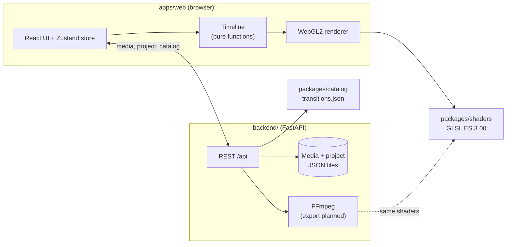

# moviemakerY2K

**A small video editor in the spirit of the 2000s — classic storyboard
editing and those unmistakable transitions, rebuilt for the browser.**

[](https://github.com/JoMe92/moviemakery2k/actions/workflows/ci.yml)
[](LICENSE)

> **Disclaimer:** moviemakerY2K is an independent open-source project. It is
> not a Microsoft product and is not affiliated with, endorsed by or sponsored
> by Microsoft. It is inspired by the classic Windows Movie Maker 2.x and
> contains no original Microsoft assets (icons, sounds, texts, shaders or
> binaries). The look is an original Y2K interpretation.


The focus is on **transitions and effects** that look and feel like the ones
from Movie Maker 2.x on Windows XP; everything else follows modern standards.
The first milestone is a clickable **slideshow prototype**.

## Features

What works today:

- **Movie Maker-style main window** — menu bar, task pane, collections,
  preview monitor and storyboard in an original Y2K theme. Areas that are not
  implemented yet are visible but disabled.
- **Picture import** — JPEG, PNG and WebP via dialog or drag & drop from the
  desktop. The backend validates the files and creates thumbnails and preview
  images.
- **Storyboard** — drag pictures into the storyboard, reorder them, remove
  them and set a duration per picture (0.5–60 s).
- **Six classic transitions** — Fade, Dissolve, Wipe, Circle, Pixelate and
  Checkerboard. Drag one onto the slot between two pictures (or double-click
  it to put it in front of the selected picture) and set its duration
  (0.25–5 s). Transitions overlap neighbouring pictures, just like
  in the original.
- **Real-time preview** — play, pause, stop, previous/next picture, seek bar
  and time display; rendered with WebGL2 in a 4:3 monitor. The space bar
  toggles playback.
- **Transition preview** — selecting a transition in the collection plays it
  in the monitor with sample pictures.
- **Autosave** — the project is saved in the backend and restored after a
  reload.

> The user interface is currently in German (e.g. *Videoübergänge* = video
> transitions, *Storyboard*, *Vorschau* = preview). English localisation is on
> the roadmap.

## Roadmap

- Export to MP4 (H.264/AAC) with FFmpeg, rendering the **same shaders** as
  the preview through headless OpenGL
- More of the original 60 transitions (SMPTE wipes, bars, iris, wheel, 3D and
  particle transitions such as Page Curl and Shatter)
- Video effects (Grayscale, Sepia, Film Age, Blur, Fade in/out …)
- Titles and credits with the Entrance → Main → Exit animation model
- Video clips, music and audio levels
- Timeline view with trimming and splitting
- English UI

## Screenshots

| | |
|---|---|
|  |  |
| **Video transitions collection.** Select a transition to preview it; drag it onto a storyboard slot to use it. | **Properties dialog.** Double-click a transition or picture in the storyboard to set its duration. |

**The six transitions at roughly 45 % progress**, captured from the preview
monitor:


**The Circle transition in motion** (SMPTE wipe 119 with a soft border):


All pictures shown are procedurally generated demo images.

## Quick start

The only prerequisite is **[Pixi](https://pixi.sh) ≥ 0.81**. Pixi installs
Python, Node.js, pnpm, FFmpeg and all tools from `pixi.lock`; nothing else
needs to be installed globally.

```bash
git clone https://github.com/JoMe92/moviemakery2k.git
cd moviemakery2k
pixi run dev    # backend + web app with live reload → http://localhost:5173
```

Or run the built app and the API from a single process on a single port:

```bash
pixi run demo   # → http://127.0.0.1:8000
```

- **Port:** the API port is set with `MMY_API_PORT` (default `8000`), e.g.
  `MMY_API_PORT=8765 pixi run dev`. The Vite dev server proxies `/api` to it.
- **Data:** uploads and the project are stored in `backend/.data/`; set
  `MMY_DATA_DIR` to use a different directory.
- **Pixi cache:** if `~/.cache` is not writable (for example a symlink to an
  unmounted drive), redirect Pixi's cache:
  `export PIXI_CACHE_DIR=/path/with/space/.cache-pixi`.
- **Docker (backend only):** `docker build -f backend/Dockerfile .`

The preview needs a browser with WebGL2 (any current Chrome, Firefox, Edge or
Safari).

## Project layout

| Path | Contents |
|---|---|
| [`apps/web/`](apps/web) | Web app: Vite + React 19 + TypeScript, Zustand, dnd-kit, WebGL2 renderer, Y2K theme |
| [`backend/`](backend) | Python 3.13 + FastAPI: media, transition catalog, project (FFmpeg export planned) |
| [`packages/shaders/`](packages/shaders) | GLSL ES 3.00 transition shaders, shared by preview and export |
| [`packages/catalog/`](packages/catalog) | Transition catalog with the documented parameters (single source of truth) |
| [`e2e/`](e2e) | Playwright browser tests, including golden frames |
| [`scripts/`](scripts) | Dev launcher, shader check, Git hooks |
| [`docs/`](docs) | [Architecture](docs/architecture.md), [ADRs](docs/adr/README.md), [research on the original](docs/research/movie-maker-reference.md) |
| [`openspec/`](openspec) | Specifications and planned changes (OpenSpec, in German) |

## Architecture



- The **catalog** defines which transitions exist and with which parameters;
  the backend validates and serves it.
- Each transition is **one GLSL file** with a small, gl-transitions-like
  contract. The browser compiles it for the preview; the planned export will
  run the very same file through headless OpenGL so that preview and output
  match.
- The **timeline** is a pure, unit-tested function, so the export can compute
  exactly the same timing as the preview.
- The **Pydantic models** are the API contract; TypeScript types are
  generated from the OpenAPI schema.

More in [docs/architecture.md](docs/architecture.md) and the
[architecture decision records](docs/adr/README.md).

## How the transitions stay faithful

There is no reference installation to copy from — and copying would not be
allowed anyway. Instead:

1. **Documented parameters.** Movie Maker 2.x defines each built-in
   transition in XML (DirectX transform GUIDs, SMPTE wipe numbers,
   `GradientSize`, `BorderSoftness`, …). These definitions are publicly
   documented; the [research notes](docs/research/movie-maker-reference.md)
   collect them with sources.
2. **Catalog with provenance.** Every entry in
   [`packages/catalog/transitions.json`](packages/catalog/transitions.json)
   records its source and marks values that could not be verified as
   *estimated*. Those can be re-tuned without touching code.
3. **Own shader implementations** of that geometry, following strict rules:
   exact source picture at progress 0 and exact target at 1, deterministic
   pseudo-randomness, pixel sizes relative to the original 640 px width.
4. **Golden-frame tests** in the browser check every transition at its
   boundaries and its characteristic geometry (wipe direction, circle growing
   from the centre, pixelate block size, deterministic dissolve). Once the
   export exists, the same frames will be compared between preview and
   export.

## Development

All commands are Pixi tasks (`pixi task list` shows them all):

| Command | What it does |
|---|---|
| `pixi run dev` | Backend with live reload + Vite dev server |
| `pixi run demo` | Build the web app and serve it together with the API |
| `pixi run check` | Quality gate: lint, typecheck, unit tests, shader check, build (same as CI) |
| `pixi run test` | Unit tests (Vitest for the web app, pytest for the backend) |
| `pixi run test-e2e` | Browser tests with Playwright/Chromium, incl. golden frames |
| `pixi run gen-api` | Regenerate the TypeScript API types from the backend's OpenAPI schema |
| `pixi run check-shaders` | Compile all shaders with glslang (GLSL ES 3.00) and check them against the catalog |
| `pixi run format` | Auto-format (Biome, Ruff) |

## Contributing

Contributions are welcome — please read [CONTRIBUTING.md](CONTRIBUTING.md)
first. In short: run `pixi run check`, use Conventional and atomic commits,
and never add Microsoft assets. The project is planned with OpenSpec and
Beads and developed with an AI-agent workflow described in
[AGENTS.md](AGENTS.md).

## License

moviemakerY2K is free software, licensed under the
[GNU General Public License v3.0 or later](LICENSE).

"Windows" and "Movie Maker" are trademarks of Microsoft Corporation, used here
only to describe what this project is inspired by.
