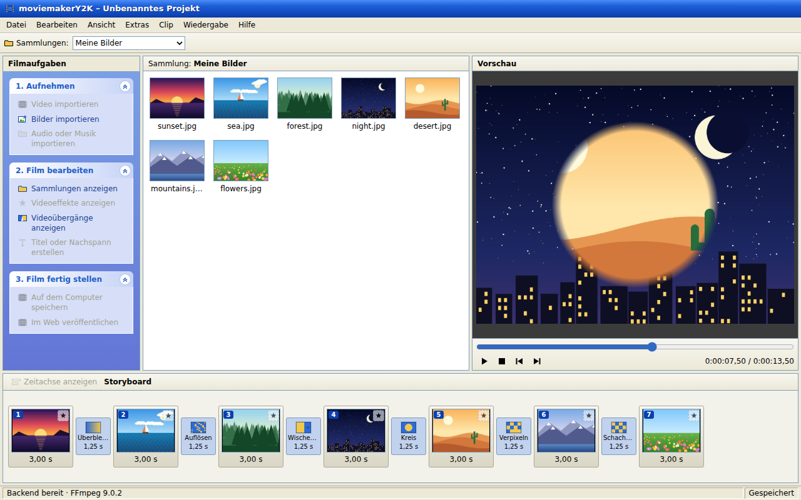
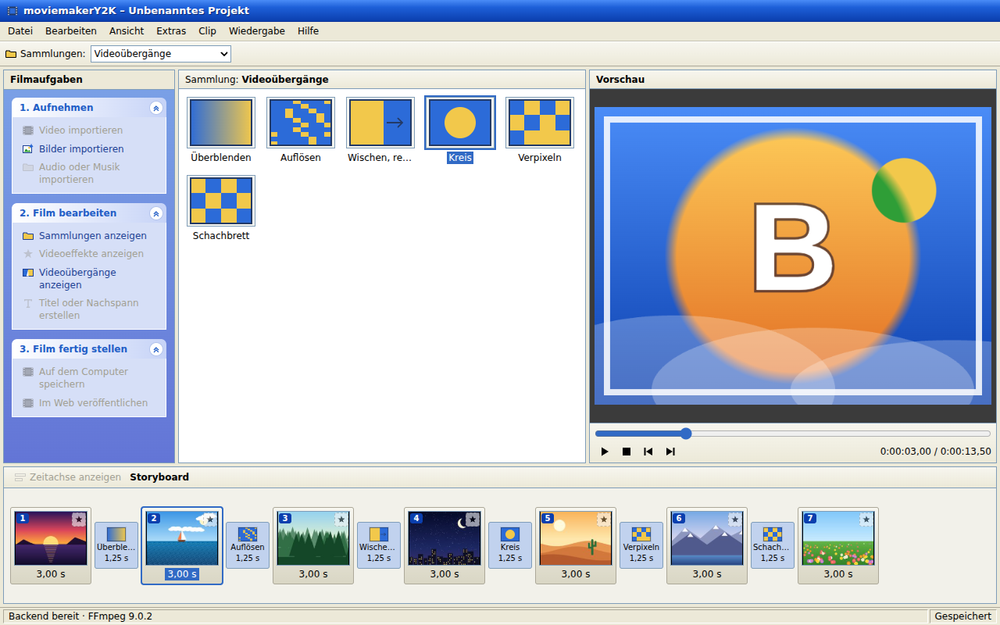
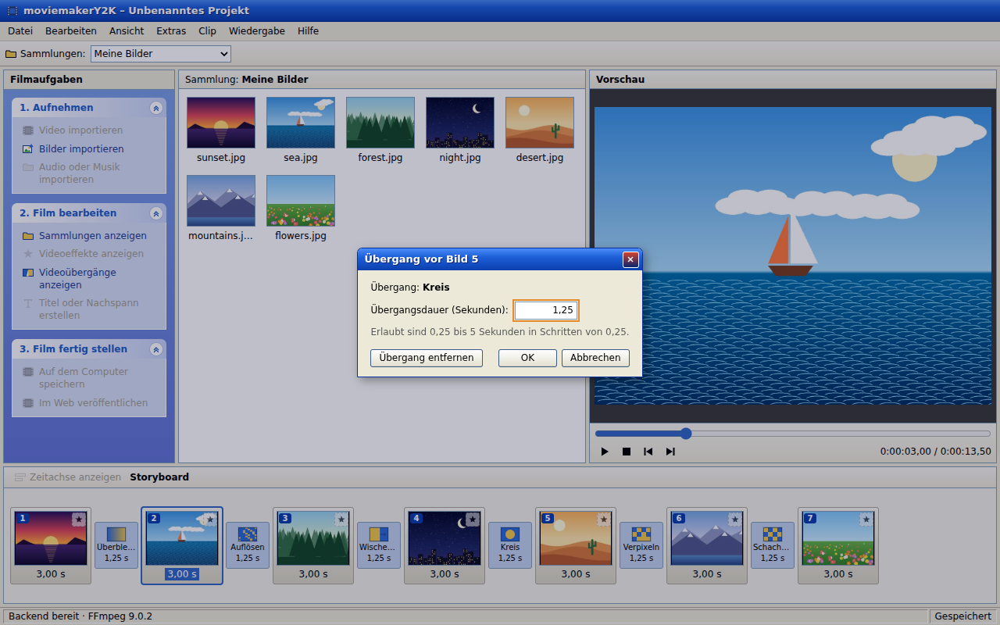
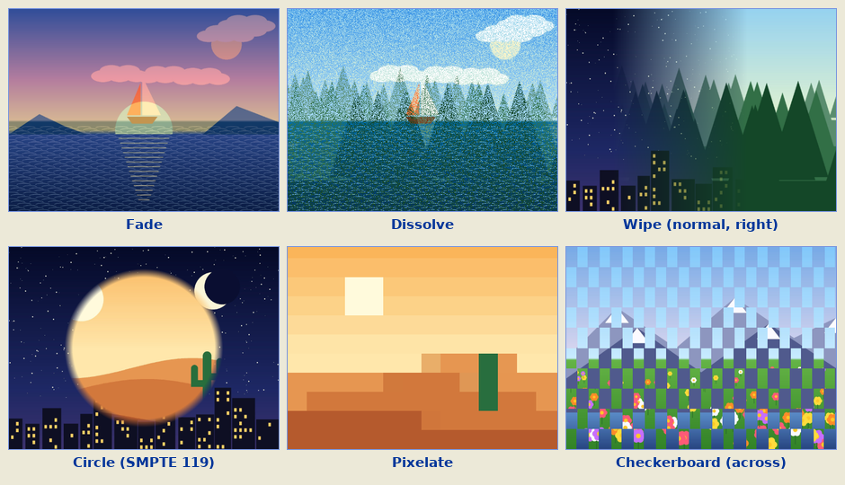
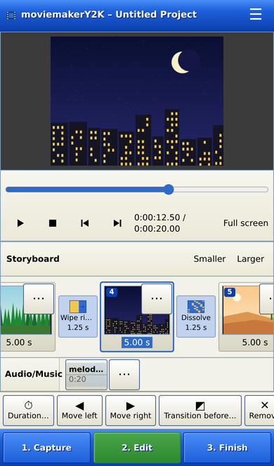
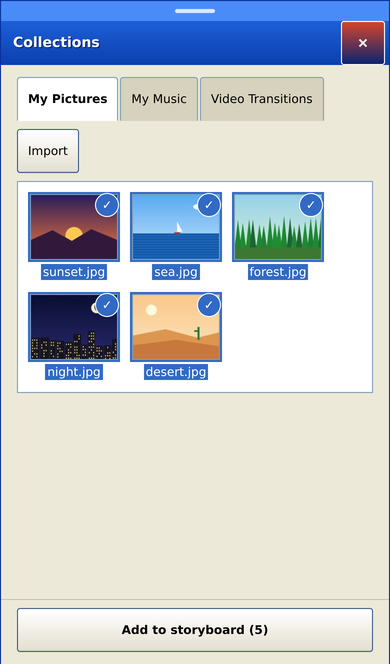
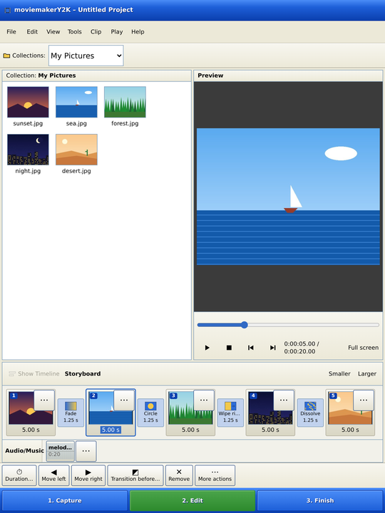
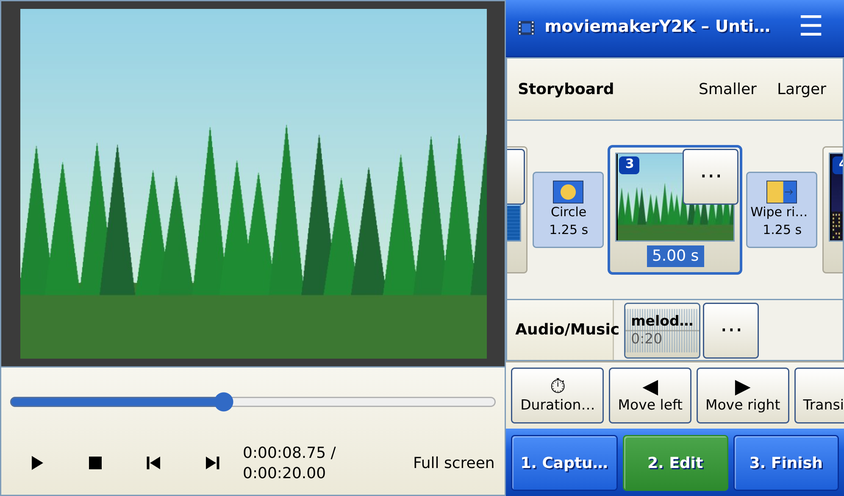
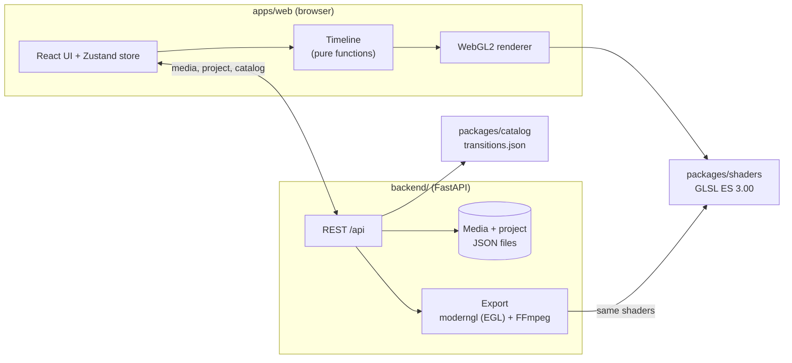

# moviemakerY2K

**A small video editor in the spirit of the 2000s — classic storyboard
editing and those unmistakable transitions, rebuilt for the browser.**

[](https://github.com/JoMe92/moviemakery2k/actions/workflows/ci.yml)
[](LICENSE)

> **Disclaimer:** moviemakerY2K is an independent open-source project. It is
> not a Microsoft product and is not affiliated with, endorsed by or sponsored
> by Microsoft. It is inspired by the classic Windows Movie Maker 2.x and
> contains no original Microsoft assets (icons, sounds, texts, shaders or
> binaries). The look is an original Y2K interpretation.



The focus is on **transitions and effects** that look and feel like the ones
from Movie Maker 2.x on Windows XP; everything else follows modern standards.
The first milestone was a clickable **slideshow prototype**; slideshows can
now be **saved as an MP4 movie**, rendered with the same shaders as the
preview, and get a **music track** that plays in the preview and is mixed
into the exported movie.

## Features

What works today:

- **Movie Maker-style main window** — menu bar, task pane, collections,
  preview monitor and storyboard in an original Y2K theme. Areas that are not
  implemented yet are visible but disabled. The toolbar's *Collections*
  toggle hides the collection pane and gives its space to the preview
  monitor; any choice of a collection brings it back, and after a reload it
  is visible again.
- **Picture import** — JPEG, PNG and WebP via dialog or drag & drop from the
  desktop. The backend validates the files and creates thumbnails and preview
  images.
- **Video import** — MP4/MOV and MKV/WebM (H.264, HEVC, VP9 or AV1) land in
  *My Videos* with a poster frame, name and duration.
- **Video clips on the storyboard** — drag a video into the storyboard like a
  picture; it plays back muted in the preview and exports with the same
  transitions. Trim its start and end in a properties dialog with a live
  poster preview at each edge, or split it at the playhead (*Clip → Split*)
  into two clips that keep the original's incoming transition on the first
  half. Clip sound and narration are not mixed with the movie yet — see
  [Roadmap](#roadmap).
- **Timeline view** — *View → Timeline* (or the storyboard pane's own toggle)
  switches to a second, proportional-width track view with a time ruler, a
  zoom slider and drag handles at each clip's edges for the same trimming;
  selection and the playhead are shared with the storyboard.
- **Music** — import MP3, WAV, M4A/AAC, OGG and FLAC into *My Music*, put
  pieces on the *Audio/Music* track below the storyboard, trim them, set
  their volume and fades, and fit the movie to the music. The preview plays
  the music in sync with pictures and transitions; the exported movie
  contains the mix. See [Music](#music).
- **Storyboard** — drag pictures into the storyboard, reorder them, remove
  them and set a duration per picture (0.5–60 s). Adding from a collection —
  by double-click, through the tile's context menu or with the collection
  sheet's button on a phone — confirms itself: a short notice names how many
  of what were added, and the one added last is scrolled into view.
- **Undo/Redo and Cut/Copy/Paste** — every storyboard and music-track change
  can be undone and redone (*Edit → Undo/Redo* or Ctrl+Z/Ctrl+Y), at least
  50 steps deep; a selected picture or music clip can be cut, copied and
  pasted elsewhere (*Edit → Cut/Copy/Paste* or Ctrl+X/C/V). Both live only in
  the browser tab and reset on a reload.
- **47 transitions** — Fade, Dissolve, Pixelate and Checkerboard, plus every
  Basic and SMPTE wipe from the original that a 2D shader can express (Wipe,
  Reveal, Split, Bow Tie, Diagonal, Rectangle, Diamond, Bars, Inset, Iris,
  Circle(s), Wheel, Star(s), Heart, Key Hole, Eye, Sweep, Fan In, Swinging
  Door, Windshield …). Drag one onto the slot between two pictures (or
  double-click it to put it in front of the selected picture) and set its
  duration (0.25–5 s). Transitions overlap neighbouring pictures, just like
  in the original.
- **21 video effects** — Sepia, Negative, Posterize, Threshold, Grayscale,
  Brightness up/down, Blur, Pixelate, Film Age (Old, Older, Oldest), Film
  Grain, Charcoal, Pen and Ink, Watercolor, Mirror horizontal/vertical and
  Rotate 90°/180°/270°. Drag one from the *Video Effects* collection onto a
  tile's effect slot; one effect per element, *No Effect* in the tile's
  context menu removes it again. The effect runs as an extra rendering pass
  before the transition, so the preview and the exported movie show the same
  pixels.
- **Titles and credits** — *Make titles or credits* in the task pane opens a
  Movie Maker-style wizard: choose where the title goes (at the beginning of
  the movie, before or on the selected element, or at the end), type one or
  two lines — or a list of entries for the credits — pick one of eight styles
  and a text colour. A title at the beginning, before an element or at the
  end becomes an element of its own with its own duration; *on the selected
  element* lays it over that picture or clip as an overlay without changing
  the element list or its duration. Every style animates in three phases
  (Entrance → Main → Exit): fade, fly in, zoom in, or the credits scrolling
  up. The monitor previews the style live while you choose it, and the
  exported movie shows the same text, the same bundled font (Liberation Sans)
  and the same animation. See [Titles and credits](#titles-and-credits).
- **AutoMovie** — *Tools → AutoMovie…* builds a whole movie from the media
  collection in one go: a title with the movie title you entered, every
  picture and video clip in import order, a closing *The End*, one transition
  between all of them and, depending on the style, an effect on every picture
  and clip. Three styles: *Classic* (Fade, no effect), *Old Movie* (Dissolve
  plus *Film Age, Older* on every element) and *Music Video* (Circle, fitted
  to the length of the music — selectable only with a music track); each
  brings its own title style. A filmstrip that is not empty is only replaced
  after a confirmation; the collection itself stays untouched, and the result
  is an ordinary project you can keep editing.
- **Real-time preview** — play, pause, stop, previous/next picture, seek bar
  and time display; rendered with WebGL2 in a 4:3 monitor. The space bar
  toggles playback.
- **Transition and effect preview** — clicking a transition in the collection
  plays it once in the monitor with sample pictures, labelled *Sample: <name>*
  (*Beispiel: <Name>*); double-clicking an effect shows it on the same sample
  picture. Opening a collection shows the project, and play, seek or selecting
  a picture returns to it.
- **Autosave** — the project is saved in the backend and restored after a
  reload.
- **Save movie** — a Movie Maker-style wizard exports the storyboard as an MP4
  (H.264 + AAC) in three quality profiles, each with a short recommendation;
  transitions are rendered by the very same shader files as the preview. See
  [Exporting a movie](#exporting-a-movie).
- **German and English UI** — the language follows the browser and can be
  switched at any time under *Tools → Options…*; numbers, durations and the
  time display follow the chosen language, and backend errors are shown
  translated. See [Languages](#languages).
- **Phones and tablets** — below 1280 px the window switches to a compact
  phone layout or a tablet layout with a taskbar of the three Movie Maker
  steps, Y2K bottom sheets and full touch operation: tap to select, long press
  or *⋯* for actions, picking instead of dragging, gestures with button
  alternatives. See [On phones and tablets](#on-phones-and-tablets).

## Roadmap

- The remaining 13 original transitions that need a 3D or particle renderer
  (Flip, Slide Up, Slide Up Center, Roll, Spin Out, Page Curl, Shatter,
  Whirlwind, Shrink) — a different rendering technique than the 2D wipe
  shaders used so far
- The effects the stateless image pass cannot express: the time-dependent
  Fade/Ease at an element's edge and the two clip-speed effects (Speed Up
  Double, Slow Down Half)
- The remaining title and credits styles beyond the eight-style MVP —
  TypeWriter, Perspective, Outline Explode, Multi and the other ~35 names of
  the original, plus the title effects that need more than a fade, a position
  or a zoom per phase
- Clip sound mixed with the music track, narration recording

## Screenshots

| | |
|---|---|
|  |  |
| **Video transitions collection.** Select a transition to preview it; drag it onto a storyboard slot to use it. | **Properties dialog.** Double-click a transition or picture in the storyboard to set its duration. |

**The original six transitions at roughly 45 % progress** (screenshots not
yet updated for the other 41), captured from the preview monitor:



**The Circle transition in motion** (SMPTE wipe 119 with a soft border):


All pictures shown are procedurally generated demo images; the screenshots
show the German UI.

## Quick start

The only prerequisite is **[Pixi](https://pixi.sh) ≥ 0.81**. Pixi installs
Python, Node.js, pnpm, FFmpeg and all tools from `pixi.lock`; nothing else
needs to be installed globally.

```bash
git clone https://github.com/JoMe92/moviemakery2k.git
cd moviemakery2k
pixi run dev    # backend + web app with live reload → http://localhost:5173
```

Or run the built app and the API from a single process on a single port:

```bash
pixi run demo   # → http://127.0.0.1:8000
```

- **Port:** the API port is set with `MMY_API_PORT` (default `8000`), e.g.
  `MMY_API_PORT=8765 pixi run dev`. The Vite dev server proxies `/api` to it.
- **Data:** uploads and the project are stored in `backend/.data/`; set
  `MMY_DATA_DIR` to use a different directory.
- **Pixi cache:** if `~/.cache` is not writable (for example a symlink to an
  unmounted drive), redirect Pixi's cache:
  `export PIXI_CACHE_DIR=/path/with/space/.cache-pixi`.
- **Docker (backend only):** see [Docker](#docker) below.

The preview needs a browser with WebGL2 (any current Chrome, Firefox, Edge or
Safari).

## Exporting a movie

Open the wizard with **Save to my computer** under *3. Finish Movie* in the
task pane, or with **File → Save Movie…** (German UI: *Auf dem Computer
speichern*, *Datei → Film speichern…*). Both are disabled while the
storyboard is empty. The wizard has four steps with *Back* / *Next* /
*Cancel*, just like the original:

1. **File name** — defaults to *My Movie* (*Mein Film* in German); the
   characters `/\:*?"<>|` are rejected and `.mp4` is appended.
2. **Quality** — choose a profile, largest to smallest; the wizard estimates
   the file size from the movie length and shows a short recommendation for
   each (e.g. *Für E-Mail/Web* — smallest file, for sending or uploading).
3. **Saving the movie** — progress in percent and an estimate of the
   remaining time; *Cancel* cancels the export after a confirmation.
4. **Finished** — *Download Movie* downloads the MP4.

| Profile | Resolution | Video | Audio |
|---|---|---|---|
| `high` (default) | 960×720, 30 fps | H.264 (High profile, CRF 20, yuv420p BT.709, faststart) | AAC, 48 kHz stereo, 128 kbit/s: the music track, or silence without music |
| `small` | 640×480, 30 fps | same | same |
| `email_web` | 320×240, 30 fps | same | same |

Pictures are letterboxed onto black exactly like in the preview monitor, and
the export uses the same timing model, so the movie matches what you saw.
Colours are converted to YUV with the **BT.709** matrix in limited range and
the MP4 is tagged accordingly (matrix, primaries, transfer `bt709`, range
`tv`) — what browsers and players assume for HD material, so the movie's
colours match the preview. The last five finished exports are kept, also
across a backend restart. While an export is waiting or running, its
pictures cannot be deleted (the UI explains why). Errors (backend,
rendering, FFmpeg) appear in a dialog that offers to try again. The same flow is available over the API (`POST /api/exports`, see
[docs/architecture.md](docs/architecture.md#export-jobs)).

**Platform support.** The export renders with headless OpenGL 3.3 through EGL
and Mesa's **llvmpipe** software renderer, which Pixi installs on Linux — no
GPU, display server or system packages needed. **Linux is the officially
supported platform** for exporting: x86-64 (CI and the Docker image) and
aarch64, e.g. a Raspberry Pi (`linux-aarch64` is a Pixi platform; the CI job
`render-arm64` runs the render/export tests on a hosted ARM runner once the
repository is public — until then aarch64 is verified by a manual run on a Raspberry Pi).
On macOS and Windows the export tries the native OpenGL context without any
guarantee; if no context can be created, the export fails with a readable
message instead of crashing. Check a machine with:

```bash
pixi run check-render-env   # EGL/llvmpipe context, test frame, FFmpeg libx264 + aac
pixi run bench-export       # export runtime: 12 pictures × 5 s per profile
```

Measured with `pixi run bench-export` (12 pictures × 5 s with 1.25 s
transitions, 46.25 s of video, 4 CPUs, software rendering): **`small` 8.5 s**
and **`high` 17.1 s** for render + encode — both faster than real time.

## Music

**Importing.** *Import audio or music* under *1. Capture Video* in the task
pane (*Audio oder Musik importieren*), *File → Import into Collections…* or
dropping files on the collection all use the same import as pictures; each
file lands in the collection of its kind, and audio appears in **My Music**
(*Meine Musik*) with its own icon, name and duration. Supported are **MP3,
WAV, M4A/AAC, OGG (Vorbis/Opus) and FLAC**, at most **100 MB and 15 minutes**
per file. The backend checks the content with ffprobe (never the file name),
keeps the original and creates a uniform preview version (AAC 48 kHz stereo)
plus waveform data. Files without an audio track or beyond the limits are
rejected with a readable message per file.

**The music track.** The narrow **Audio/Music** track (*Audio/Musik*) below
the storyboard holds the pieces of music. They play one after another from
0:00, without gaps; there are no free start times or overlaps. Each block
shows the name, the played length and a mini waveform, and its width is
proportional to the length.

- **Add** by dragging audio from *My Music* onto the track, by double-clicking
  it, or with *Add to Music Track* in its context menu. Pictures are refused
  on the music track and audio on the storyboard, each with a hint.
- **Reorder** by dragging (or with the keyboard, like storyboard tiles);
  **remove** with the *Delete* key or *Remove* in the context menu. Deleting
  an audio file from *My Music* also removes it from the music track.
- **Edit** via the context menu (right click, the context-menu key or
  Shift+F10): *Volume…* (0–200 %), *Fade In* and *Fade Out* (switches, 1 s
  each) and *Trim…* (start and end, `m:ss.cc` or seconds; a piece plays at
  least 0.5 s).
- **Music longer than the movie** is cut at the end of the movie and always
  faded out over the last second; the track says so (*Music 3:12 / Movie
  2:40 – will be cut at the end*). **Shorter music** is followed by silence.
- **Fit Movie to Music** in the *Clip* menu (*Film an Musik anpassen*)
  spreads the length of the music evenly over the pictures, taking the
  transitions into account (rounded to 0.25 s, 0.5–60 s per picture; the
  remainder goes to the last picture). If the music is too long or too short
  for the existing pictures, a dialog names the reachable duration and
  nothing changes. The item is disabled without music or without pictures.

**Preview and export.** The preview player plays the music with Web Audio in
sync with pictures and transitions: while music is scheduled, the audio clock
drives playback, so picture and sound cannot drift apart. Browsers only allow
sound after a user action, so the music starts with the first click on play
(or the space bar). The transition sample in the collection plays without
music. The export mixes the music from the original files (not the preview
version) into the movie's AAC track, exactly as long as the video; a movie
without music keeps a silent track.

Not included (yet): a timeline with freely placed audio clips, sound of video
clips, narration, adjustable fade lengths, cross-fades between pieces, audio
effects and loudness normalisation.

## Titles and credits

**The wizard.** *Make titles or credits* under *2. Edit Movie* in the task
pane (*Titel oder Nachspann erstellen*) opens a modal wizard with four steps
and the original's *Back* / *Next* / *Cancel* buttons; it is fully operable
from the keyboard.

1. **Placement.** *At the beginning of the movie* and *At the end of the
   movie* are always available. *Before the selected element* needs a
   selected storyboard element, and *On the selected element* a selected
   picture or video clip — a title element cannot carry a title of its own,
   so that option stays unavailable for one. Unavailable options say why.
2. **Text.** Two lines for a title; a style with the *credits* layout asks
   for a list instead, one entry per line, and carries whatever the two
   lines already held into it.
3. **Style.** One of the eight styles, with a live preview in the monitor.
4. **Colour.** A text colour from a fixed palette. The font is always the
   bundled **Liberation Sans**, shipped with the app so the preview and the
   export use the very same glyphs.

After *Finish* the title appears at the chosen place and is selected.

**The eight styles.** Four single-line (*Basic Title*, *Fly In*, *Zoom In*,
*Subtitle*), two two-line (*Fade In and Out*, *Fly In Fades*) and two credits
styles (*Scroll Up Stacked*, *Fade In and Out*). Each one animates in the
original's three phases — **Entrance → Main → Exit**, one second for the
entrance and the exit each, the rest in between — where a phase either fades
the text, holds it still, or moves and scales it. The credits scroll is that
same movement during *Main*, not a separate mechanism: *Scroll Up Stacked*
moves its list from below the frame to above it while the static credits
style just fades the whole list in and out.

**Element or overlay.** A title at the beginning, before an element or at the
end is an **element of its own**: it refers to no medium, shows white text on
black and has its own display duration (5 s, 10 s for credits), which you can
change like a picture's. It can carry an incoming transition like any other
element. *On the selected element* instead sets that picture's or clip's
**overlay title**: the text is composited over the picture, follows the
element's own duration and stays visible for a whole transition into the next
element, moving by its own phases while the transition runs.

**Preview and export.** Both draw the title the same way — the text is
rasterised to a canvas with the bundled font, then drawn through the same
GLSL program with the same position, zoom and opacity for a given moment, so
the exported movie shows the same text, font and animation as the monitor.

Not included (yet): the original's remaining ~35 style names and the title
effects that need more than a fade, a position or a zoom per phase
(TypeWriter, Perspective, Outline Explode, Multi …) — see
[Roadmap](#roadmap).

## Languages

The user interface is available in **German** and **English**. On first
start it follows the browser:

1. a language chosen earlier under **Tools → Options…** (*Extras →
   Optionen…*; stored in `localStorage` as `mmy.locale`),
2. otherwise the first browser language that starts with `de` or `en`
   (`de-AT` → German, `en-GB` → English),
3. otherwise English (e.g. `fr-FR`).

Switching in the Options dialog takes effect immediately, without a reload,
and leaves the project untouched. Number formats follow the language: the
time display reads `0:00:12,50` in German and `0:00:12.50` in English, and
duration fields accept both `,` and `.` in either language. Transition names
are localised too (*Kreis* / *Circle*).

**Adding or checking translations.** All visible text lives in the message
catalogs under [`apps/web/src/i18n/`](apps/web/src/i18n):

- [`en.ts`](apps/web/src/i18n/en.ts) is the reference catalog; its shape
  defines the `Messages` type. Add new keys here first, grouped by UI area
  (`menu.file.saveMovie`). `{name}` is a placeholder; `{ one, other }` is a
  plural message selected by the `count` param.
- [`de.ts`](apps/web/src/i18n/de.ts) ends in `satisfies Messages`, so a
  missing key is a type error (`pixi run check` fails).
- A parity test (`apps/web/src/i18n/t.test.ts`) checks that both catalogs
  have the same keys and no empty values.
- Components get text from `useT()` (`t("menu.file.label")`); never put
  visible text directly into component code.
- Backend errors carry a stable code from the backend's `ErrorCode` enum;
  the UI shows the catalog entry `errors.<code>` (e.g.
  `errors.export.emptyProject`). The enum is part of the OpenAPI schema, so
  the generated TypeScript type `ErrorCode` lists every code and the
  `errors` catalog is keyed by it: after `pixi run gen-api`, a new backend
  code without a text in both catalogs is a type error. Validation errors
  about a storyboard picture are prefixed with its number (*Picture 2: …*).
- Transition names live in the catalog
  ([`packages/catalog/transitions.json`](packages/catalog/transitions.json)),
  not in the web app.

**Breaking API changes for contributors** (the TypeScript types are
regenerated with `pixi run gen-api`):

- Catalog entries replace `name` (string) with `names`
  (`{"de": "Kreis", "en": "Circle"}`, both required).
- The backend's own errors answer with
  `{"detail": {"code": "export.emptyProject", "params": {…}, "message": "<English>"}}`
  instead of a German `detail` string. FastAPI's own `422` validation lists
  are unchanged.
- Failed upload results and export jobs carry the same three fields:
  `errorCode`, `errorParams` and an English `message`; the former `error`
  field is gone (it held the code for uploads and the message for exports).

Code comments, docstrings, Pixi task descriptions and CI step names are in
English; German text belongs only in `de.ts`, in tests of the German UI and
in the OpenSpec artefacts.

## On phones and tablets

The same app adapts to the window size; nothing changes on the desktop.

| Mode | Window | Layout |
|---|---|---|
| **Wide** | 1280 px and wider | The Movie Maker window described above |
| **Medium** | 600–1279 px (tablet, phone in landscape above 500 px height) | Menu bar, collection and monitor side by side, storyboard below, taskbar at the bottom |
| **Compact** | narrower than 600 px, or landscape below 500 px height | Title bar with *☰*, monitor (at most 45 % of the height) with its control bar, storyboard and music track, action bar, taskbar; in landscape the monitor sits on the left |

| Phone, portrait | Picking pictures | Tablet |
|---|---|---|
|  |  |  |



**Taskbar and sheets.** The taskbar at the bottom carries the three steps
*1. Capture*, *2. Edit* and *3. Finish*; each opens a sheet with the entries of
the task pane group of the same name (disabled entries stay visible). On a
phone *☰* opens the *Menu* sheet with all seven menus, and every dialog
appears as a bottom sheet in the Y2K window style. A sheet closes with its
close button, Escape, a tap on the backdrop or a swipe down at the grip.

**Touch operation** applies on phones and whenever the pointer is coarse
(touch screen); every interactive element is then at least 44 × 44 px.

- **Tap** selects a picture or music clip; the **action bar** above the
  taskbar offers its actions (*Duration…*, *Move left/right*, *Transition
  before…*, *Remove*; for music *Volume…*, *Trim…*, *Fade in/out*, *Move*,
  *Remove*). A **long press** (400 ms) or the *⋯* button opens the same menu
  as a right click on the desktop, as an action sheet.
- **Adding** works by picking instead of dragging: *2. Edit → View
  collections* opens the collection sheet; tap pictures (or music) in the
  order you want them, then *Add to storyboard (n)* / *Add to music track
  (n)*. Pictures go after the selected picture or to the end. A short notice
  then names what was added, the new elements are scrolled into view, and the
  phone vibrates briefly.
- **Reordering**: long press a tile or clip and drag it, or use *Move
  left/right*. A quick swipe scrolls the strip instead. On a tablet you can
  also drag pictures from the collection into the storyboard.
- **Transitions**: tap the slot between two pictures to open the
  *Transition* sheet; choosing one sets it at once and plays it once in the
  monitor, the duration has a stepper (0.25–5 s).
- **Numbers**: duration, volume and trim dialogs add steppers and sliders
  (0.5 s, 0.25 s, 5 %, 0.1 s); *Trim…* also shows the waveform with two
  handles that play two seconds from the mark when released. The *Save
  Movie* wizard fills the screen.
- **Gestures**, each with a button: swipe in the monitor for the previous or
  next picture, double-tap (or *Full screen*) for the full-screen preview,
  pinch the storyboard (or *Smaller*/*Larger*) for three tile sizes, which
  are remembered.
- **Haptics**: a short vibration on a long press, a drop, a refused drop and
  an add from the collection, switchable under *Tools → Options… →
  Vibration*. It is always an addition — the notice and the scrolling confirm
  an add on their own.

**iOS and iPadOS.** Safari has no Vibration API, so there is no haptic
feedback and the *Vibration* switch is not shown. The ring/silent switch
mutes Web Audio, so the preview music is silent while the phone is in silent
mode (the exported movie is not affected). Safari on the iPhone does not
offer full screen for page elements; the preview then covers the whole
viewport instead. iOS converts HEIC photos to JPEG when you pick them, so
they import like any other picture.

### Using it on your phone

`pixi run serve-lan` serves the app and the API in your home network with an
access token: the terminal shows the addresses with the token and a QR code.
Scan it with the phone and the app opens; the phone stays signed in for 30
days, and devices without the token only see *Access required*.

```bash
pixi run serve-lan                                    # HTTP, port 8080
pixi run serve-lan --cert lan.pem --key lan-key.pem   # HTTPS, port 8443
pixi run serve-lan --rotate-token                     # invalidate old links
```

Over HTTPS the app can be installed (*Tools → Install as app…*), starts from
its own icon without the browser bar, and the *Save Movie* wizard offers
*Share…* for the finished MP4 (up to 200 MB). [docs/mobile.md](docs/mobile.md)
explains HTTPS with Tailscale or mkcert, iOS and Android certificate trust,
and the security limits (the token is in the link, plain HTTP is not
encrypted, there are no user accounts).

## Docker

The backend image is built from the Pixi environment `prod` (Python, FFmpeg
and Mesa llvmpipe from `pixi.lock`), so it can export movies without a GPU.
The build checks the render environment and fails if EGL or the encoders are
missing.

```bash
docker build -f backend/Dockerfile -t moviemakery2k .
docker run --rm -p 8000:8000 -v mmy-data:/data moviemakery2k
curl http://127.0.0.1:8000/api/health
```

The image serves the API only (no web app); point a dev server
(`pixi run dev-web`) at it, or drive it over HTTP. Media, the project and
exports live in the `/data` volume. An export over the API:

```bash
curl -X POST http://127.0.0.1:8000/api/exports \
  -H 'Content-Type: application/json' -d '{"profile": "small", "fileName": "Mein Film"}'
# → 202 {"id": "<id>", "status": "queued", …}
curl http://127.0.0.1:8000/api/exports/<id>        # status + progress, until "done"
curl -OJ http://127.0.0.1:8000/api/exports/<id>/file
```

`scripts/docker_export_smoke.sh` does all of this end to end (build, upload
two pictures, save a project, export, check the MP4 with ffprobe) and runs in
CI; with `BASE_URL=http://127.0.0.1:8000` it tests an already running backend
instead.

## Project layout

| Path | Contents |
|---|---|
| [`apps/web/`](apps/web) | Web app: Vite + React 19 + TypeScript, Zustand, dnd-kit, WebGL2 renderer, Y2K theme |
| [`backend/`](backend) | Python 3.13 + FastAPI: media (pictures, video and audio), transition, effect and title catalogs, project, MP4 export with music mixdown (moderngl + FFmpeg) |
| [`packages/shaders/`](packages/shaders) | GLSL ES 3.00 transition and effect shaders, shared by preview and export |
| [`packages/catalog/`](packages/catalog) | Transition, effect, title and AutoMovie catalogs with the documented parameters (single source of truth) |
| [`packages/fonts/`](packages/fonts) | The bundled title font (Liberation Sans), shared by preview and export |
| [`e2e/`](e2e) | Playwright browser tests, including golden frames |
| [`scripts/`](scripts) | Dev launcher, shader and render-environment checks, export benchmark and Docker smoke test, Git hooks |
| [`docs/`](docs) | [Architecture](docs/architecture.md), [ADRs](docs/adr/README.md), [research on the original](docs/research/movie-maker-reference.md) |
| [`openspec/`](openspec) | Specifications and planned changes (OpenSpec, in German) |

## Architecture



- The **catalog** defines which transitions exist and with which parameters;
  the backend validates and serves it.
- Each transition is **one GLSL file** with a small, gl-transitions-like
  contract. The browser compiles it for the preview; the export runs the very
  same file through headless OpenGL (only the `#version` line changes), so
  preview and movie match.
- The **timeline** is a pure, unit-tested function in TypeScript with a Python
  port for the export; both are checked against the same test vectors.
  The **music schedule** (which piece plays when, with trims, volume and
  fades) works the same way, so preview and movie place the music
  identically.
- The **Pydantic models** are the API contract; TypeScript types are
  generated from the OpenAPI schema.

More in [docs/architecture.md](docs/architecture.md) and the
[architecture decision records](docs/adr/README.md).

## How the transitions stay faithful

There is no reference installation to copy from — and copying would not be
allowed anyway. Instead:

1. **Documented parameters.** Movie Maker 2.x defines each built-in
   transition in XML (DirectX transform GUIDs, SMPTE wipe numbers,
   `GradientSize`, `BorderSoftness`, …). These definitions are publicly
   documented; the [research notes](docs/research/movie-maker-reference.md)
   collect them with sources.
2. **Catalog with provenance.** Every entry in
   [`packages/catalog/transitions.json`](packages/catalog/transitions.json)
   records its source and marks values that could not be verified as
   *estimated*. Those can be re-tuned without touching code.
3. **Own shader implementations** of that geometry, following strict rules:
   exact source picture at progress 0 and exact target at 1, deterministic
   pseudo-randomness, pixel sizes relative to the original 640 px width.
4. **Golden-frame tests** in the browser check every transition at its
   boundaries and its characteristic geometry (wipe direction, circle growing
   from the centre, pixelate block size, deterministic dissolve). The same
   frames are rendered by the export and compared with the preview for every
   transition (at most 2 levels per channel apart on ≥ 99.5 % of the pixels).

## Development

All commands are Pixi tasks (`pixi task list` shows them all):

| Command | What it does |
|---|---|
| `pixi run dev` | Backend with live reload + Vite dev server |
| `pixi run demo` | Build the web app and serve it together with the API |
| `pixi run check` | Quality gate: lint (incl. Ruff on `e2e/` and `scripts/`), typecheck, unit tests, shader check, build (same as CI) |
| `pixi run test` | Unit tests (Vitest for the web app, pytest for the backend) |
| `pixi run test-e2e` | Browser tests with Playwright/Chromium, incl. golden frames |
| `pixi run gen-api` | Regenerate the TypeScript API types from the backend's OpenAPI schema |
| `pixi run check-shaders` | Compile all shaders with glslang (GLSL ES 3.00) and check them against the catalog |
| `pixi run check-render-env` | Check the export renderer: EGL/llvmpipe context, test frame, FFmpeg `libx264` + `aac` |
| `pixi run bench-export` | Measure export runtime (12 pictures × 5 s) per profile |
| `pixi run format` | Auto-format (Biome, Ruff) |

## Contributing

Contributions are welcome — please read [CONTRIBUTING.md](CONTRIBUTING.md)
first. In short: run `pixi run check`, use Conventional and atomic commits,
and never add Microsoft assets. The project is planned with OpenSpec and
Beads and developed with an AI-agent workflow described in
[AGENTS.md](AGENTS.md).

## License

moviemakerY2K is free software, licensed under the
[GNU General Public License v3.0 or later](LICENSE).

"Windows" and "Movie Maker" are trademarks of Microsoft Corporation, used here
only to describe what this project is inspired by.
