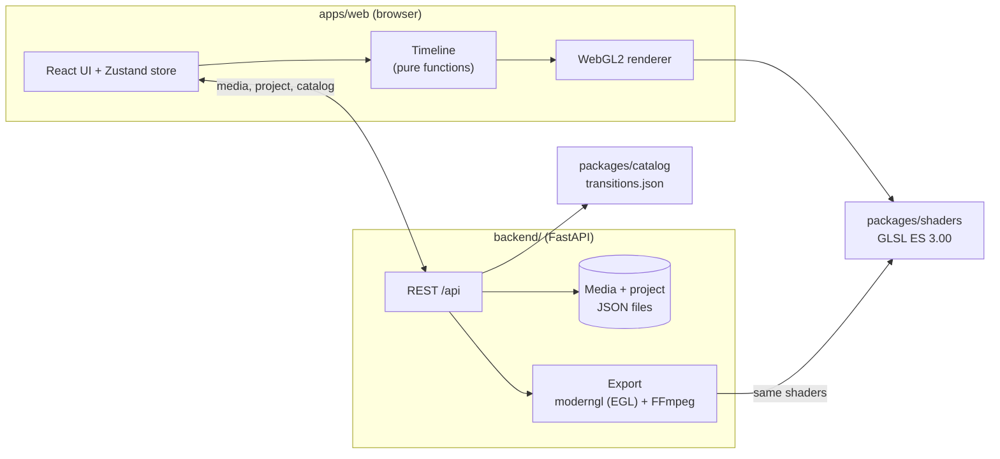

# moviemakerY2K

**A small video editor in the spirit of the 2000s — classic storyboard
editing and those unmistakable transitions, rebuilt for the browser.**

[](https://github.com/JoMe92/moviemakery2k/actions/workflows/ci.yml)
[](LICENSE)

> **Disclaimer:** moviemakerY2K is an independent open-source project. It is
> not a Microsoft product and is not affiliated with, endorsed by or sponsored
> by Microsoft. It is inspired by the classic Windows Movie Maker 2.x and
> contains no original Microsoft assets (icons, sounds, texts, shaders or
> binaries). The look is an original Y2K interpretation.


The focus is on **transitions and effects** that look and feel like the ones
from Movie Maker 2.x on Windows XP; everything else follows modern standards.
The first milestone was a clickable **slideshow prototype**; slideshows can
now be **saved as an MP4 movie**, rendered with the same shaders as the
preview.

## Features

What works today:

- **Movie Maker-style main window** — menu bar, task pane, collections,
  preview monitor and storyboard in an original Y2K theme. Areas that are not
  implemented yet are visible but disabled.
- **Picture import** — JPEG, PNG and WebP via dialog or drag & drop from the
  desktop. The backend validates the files and creates thumbnails and preview
  images.
- **Storyboard** — drag pictures into the storyboard, reorder them, remove
  them and set a duration per picture (0.5–60 s).
- **Six classic transitions** — Fade, Dissolve, Wipe, Circle, Pixelate and
  Checkerboard. Drag one onto the slot between two pictures (or double-click
  it to put it in front of the selected picture) and set its duration
  (0.25–5 s). Transitions overlap neighbouring pictures, just like
  in the original.
- **Real-time preview** — play, pause, stop, previous/next picture, seek bar
  and time display; rendered with WebGL2 in a 4:3 monitor. The space bar
  toggles playback.
- **Transition preview** — clicking a transition in the collection plays it
  once in the monitor with sample pictures, labelled *Sample: <name>*
  (*Beispiel: <Name>*); opening the collection shows the project, and play,
  seek or selecting a picture returns to it.
- **Autosave** — the project is saved in the backend and restored after a
  reload.
- **Save movie** — a Movie Maker-style wizard exports the storyboard as an MP4
  (H.264 + AAC) in two quality profiles; transitions are rendered by the very
  same shader files as the preview. See [Exporting a movie](#exporting-a-movie).
- **German and English UI** — the language follows the browser and can be
  switched at any time under *Tools → Options…*; numbers, durations and the
  time display follow the chosen language, and backend errors are shown
  translated. See [Languages](#languages).

## Roadmap

- **Next:** music — a background audio track for the slideshow (the export
  already writes a silent AAC track that music will replace)
- More of the original 60 transitions (SMPTE wipes, bars, iris, wheel, 3D and
  particle transitions such as Page Curl and Shatter)
- Video effects (Grayscale, Sepia, Film Age, Blur, Fade in/out …)
- Titles and credits with the Entrance → Main → Exit animation model
- Video clips, music and audio levels
- Timeline view with trimming and splitting

## Screenshots

| | |
|---|---|
|  |  |
| **Video transitions collection.** Select a transition to preview it; drag it onto a storyboard slot to use it. | **Properties dialog.** Double-click a transition or picture in the storyboard to set its duration. |

**The six transitions at roughly 45 % progress**, captured from the preview
monitor:


**The Circle transition in motion** (SMPTE wipe 119 with a soft border):


All pictures shown are procedurally generated demo images; the screenshots
show the German UI.

## Quick start

The only prerequisite is **[Pixi](https://pixi.sh) ≥ 0.81**. Pixi installs
Python, Node.js, pnpm, FFmpeg and all tools from `pixi.lock`; nothing else
needs to be installed globally.

```bash
git clone https://github.com/JoMe92/moviemakery2k.git
cd moviemakery2k
pixi run dev    # backend + web app with live reload → http://localhost:5173
```

Or run the built app and the API from a single process on a single port:

```bash
pixi run demo   # → http://127.0.0.1:8000
```

- **Port:** the API port is set with `MMY_API_PORT` (default `8000`), e.g.
  `MMY_API_PORT=8765 pixi run dev`. The Vite dev server proxies `/api` to it.
- **Data:** uploads and the project are stored in `backend/.data/`; set
  `MMY_DATA_DIR` to use a different directory.
- **Pixi cache:** if `~/.cache` is not writable (for example a symlink to an
  unmounted drive), redirect Pixi's cache:
  `export PIXI_CACHE_DIR=/path/with/space/.cache-pixi`.
- **Docker (backend only):** see [Docker](#docker) below.

The preview needs a browser with WebGL2 (any current Chrome, Firefox, Edge or
Safari).

## Exporting a movie

Open the wizard with **Save to my computer** under *3. Finish Movie* in the
task pane, or with **File → Save Movie…** (German UI: *Auf dem Computer
speichern*, *Datei → Film speichern…*). Both are disabled while the
storyboard is empty. The wizard has four steps with *Back* / *Next* /
*Cancel*, just like the original:

1. **File name** — defaults to *My Movie* (*Mein Film* in German); the
   characters `/\:*?"<>|` are rejected and `.mp4` is appended.
2. **Quality** — choose a profile; the wizard estimates the file size from
   the movie length.
3. **Saving the movie** — progress in percent and an estimate of the
   remaining time; *Cancel* cancels the export after a confirmation.
4. **Finished** — *Download Movie* downloads the MP4.

| Profile | Resolution | Video | Audio |
|---|---|---|---|
| `high` (default) | 960×720, 30 fps | H.264 (High profile, CRF 20, yuv420p BT.709, faststart) | silent AAC, 48 kHz stereo, 128 kbit/s |
| `small` | 640×480, 30 fps | same | same |

Pictures are letterboxed onto black exactly like in the preview monitor, and
the export uses the same timing model, so the movie matches what you saw.
Colours are converted to YUV with the **BT.709** matrix in limited range and
the MP4 is tagged accordingly (matrix, primaries, transfer `bt709`, range
`tv`) — what browsers and players assume for HD material, so the movie's
colours match the preview. The last five finished exports are kept, also
across a backend restart. While an export is waiting or running, its
pictures cannot be deleted (the UI explains why). Errors (backend,
rendering, FFmpeg) appear in a dialog that offers to try again. The same flow is available over the API (`POST /api/exports`, see
[docs/architecture.md](docs/architecture.md#export-jobs)).

**Platform support.** The export renders with headless OpenGL 3.3 through EGL
and Mesa's **llvmpipe** software renderer, which Pixi installs on Linux — no
GPU, display server or system packages needed. **Linux is the officially
supported platform** for exporting: x86-64 (CI and the Docker image) and
aarch64, e.g. a Raspberry Pi (`linux-aarch64` is a Pixi platform; the CI job
`render-arm64` runs the render/export tests on a hosted ARM runner once the
repository is public — until then aarch64 is verified by a manual run on a Raspberry Pi).
On macOS and Windows the export tries the native OpenGL context without any
guarantee; if no context can be created, the export fails with a readable
message instead of crashing. Check a machine with:

```bash
pixi run check-render-env   # EGL/llvmpipe context, test frame, FFmpeg libx264 + aac
pixi run bench-export       # export runtime: 12 pictures × 5 s per profile
```

Measured with `pixi run bench-export` (12 pictures × 5 s with 1.25 s
transitions, 46.25 s of video, 4 CPUs, software rendering): **`small` 8.5 s**
and **`high` 17.1 s** for render + encode — both faster than real time.

## Languages

The user interface is available in **German** and **English**. On first
start it follows the browser:

1. a language chosen earlier under **Tools → Options…** (*Extras →
   Optionen…*; stored in `localStorage` as `mmy.locale`),
2. otherwise the first browser language that starts with `de` or `en`
   (`de-AT` → German, `en-GB` → English),
3. otherwise English (e.g. `fr-FR`).

Switching in the Options dialog takes effect immediately, without a reload,
and leaves the project untouched. Number formats follow the language: the
time display reads `0:00:12,50` in German and `0:00:12.50` in English, and
duration fields accept both `,` and `.` in either language. Transition names
are localised too (*Kreis* / *Circle*).

**Adding or checking translations.** All visible text lives in the message
catalogs under [`apps/web/src/i18n/`](apps/web/src/i18n):

- [`en.ts`](apps/web/src/i18n/en.ts) is the reference catalog; its shape
  defines the `Messages` type. Add new keys here first, grouped by UI area
  (`menu.file.saveMovie`). `{name}` is a placeholder; `{ one, other }` is a
  plural message selected by the `count` param.
- [`de.ts`](apps/web/src/i18n/de.ts) ends in `satisfies Messages`, so a
  missing key is a type error (`pixi run check` fails).
- A parity test (`apps/web/src/i18n/t.test.ts`) checks that both catalogs
  have the same keys and no empty values.
- Components get text from `useT()` (`t("menu.file.label")`); never put
  visible text directly into component code.
- Backend errors carry a stable code from the backend's `ErrorCode` enum;
  the UI shows the catalog entry `errors.<code>` (e.g.
  `errors.export.emptyProject`). The enum is part of the OpenAPI schema, so
  the generated TypeScript type `ErrorCode` lists every code and the
  `errors` catalog is keyed by it: after `pixi run gen-api`, a new backend
  code without a text in both catalogs is a type error. Validation errors
  about a storyboard picture are prefixed with its number (*Picture 2: …*).
- Transition names live in the catalog
  ([`packages/catalog/transitions.json`](packages/catalog/transitions.json)),
  not in the web app.

**Breaking API changes for contributors** (the TypeScript types are
regenerated with `pixi run gen-api`):

- Catalog entries replace `name` (string) with `names`
  (`{"de": "Kreis", "en": "Circle"}`, both required).
- The backend's own errors answer with
  `{"detail": {"code": "export.emptyProject", "params": {…}, "message": "<English>"}}`
  instead of a German `detail` string. FastAPI's own `422` validation lists
  are unchanged.
- Failed upload results and export jobs carry the same three fields:
  `errorCode`, `errorParams` and an English `message`; the former `error`
  field is gone (it held the code for uploads and the message for exports).

Code comments, docstrings, Pixi task descriptions and CI step names are in
English; German text belongs only in `de.ts`, in tests of the German UI and
in the OpenSpec artefacts.

## Docker

The backend image is built from the Pixi environment `prod` (Python, FFmpeg
and Mesa llvmpipe from `pixi.lock`), so it can export movies without a GPU.
The build checks the render environment and fails if EGL or the encoders are
missing.

```bash
docker build -f backend/Dockerfile -t moviemakery2k .
docker run --rm -p 8000:8000 -v mmy-data:/data moviemakery2k
curl http://127.0.0.1:8000/api/health
```

The image serves the API only (no web app); point a dev server
(`pixi run dev-web`) at it, or drive it over HTTP. Media, the project and
exports live in the `/data` volume. An export over the API:

```bash
curl -X POST http://127.0.0.1:8000/api/exports \
  -H 'Content-Type: application/json' -d '{"profile": "small", "fileName": "Mein Film"}'
# → 202 {"id": "<id>", "status": "queued", …}
curl http://127.0.0.1:8000/api/exports/<id>        # status + progress, until "done"
curl -OJ http://127.0.0.1:8000/api/exports/<id>/file
```

`scripts/docker_export_smoke.sh` does all of this end to end (build, upload
two pictures, save a project, export, check the MP4 with ffprobe) and runs in
CI; with `BASE_URL=http://127.0.0.1:8000` it tests an already running backend
instead.

## Project layout

| Path | Contents |
|---|---|
| [`apps/web/`](apps/web) | Web app: Vite + React 19 + TypeScript, Zustand, dnd-kit, WebGL2 renderer, Y2K theme |
| [`backend/`](backend) | Python 3.13 + FastAPI: media, transition catalog, project, MP4 export (moderngl + FFmpeg) |
| [`packages/shaders/`](packages/shaders) | GLSL ES 3.00 transition shaders, shared by preview and export |
| [`packages/catalog/`](packages/catalog) | Transition catalog with the documented parameters (single source of truth) |
| [`e2e/`](e2e) | Playwright browser tests, including golden frames |
| [`scripts/`](scripts) | Dev launcher, shader and render-environment checks, export benchmark and Docker smoke test, Git hooks |
| [`docs/`](docs) | [Architecture](docs/architecture.md), [ADRs](docs/adr/README.md), [research on the original](docs/research/movie-maker-reference.md) |
| [`openspec/`](openspec) | Specifications and planned changes (OpenSpec, in German) |

## Architecture



- The **catalog** defines which transitions exist and with which parameters;
  the backend validates and serves it.
- Each transition is **one GLSL file** with a small, gl-transitions-like
  contract. The browser compiles it for the preview; the export runs the very
  same file through headless OpenGL (only the `#version` line changes), so
  preview and movie match.
- The **timeline** is a pure, unit-tested function in TypeScript with a Python
  port for the export; both are checked against the same test vectors.
- The **Pydantic models** are the API contract; TypeScript types are
  generated from the OpenAPI schema.

More in [docs/architecture.md](docs/architecture.md) and the
[architecture decision records](docs/adr/README.md).

## How the transitions stay faithful

There is no reference installation to copy from — and copying would not be
allowed anyway. Instead:

1. **Documented parameters.** Movie Maker 2.x defines each built-in
   transition in XML (DirectX transform GUIDs, SMPTE wipe numbers,
   `GradientSize`, `BorderSoftness`, …). These definitions are publicly
   documented; the [research notes](docs/research/movie-maker-reference.md)
   collect them with sources.
2. **Catalog with provenance.** Every entry in
   [`packages/catalog/transitions.json`](packages/catalog/transitions.json)
   records its source and marks values that could not be verified as
   *estimated*. Those can be re-tuned without touching code.
3. **Own shader implementations** of that geometry, following strict rules:
   exact source picture at progress 0 and exact target at 1, deterministic
   pseudo-randomness, pixel sizes relative to the original 640 px width.
4. **Golden-frame tests** in the browser check every transition at its
   boundaries and its characteristic geometry (wipe direction, circle growing
   from the centre, pixelate block size, deterministic dissolve). The same
   frames are rendered by the export and compared with the preview for every
   transition (at most 2 levels per channel apart on ≥ 99.5 % of the pixels).

## Development

All commands are Pixi tasks (`pixi task list` shows them all):

| Command | What it does |
|---|---|
| `pixi run dev` | Backend with live reload + Vite dev server |
| `pixi run demo` | Build the web app and serve it together with the API |
| `pixi run check` | Quality gate: lint (incl. Ruff on `e2e/` and `scripts/`), typecheck, unit tests, shader check, build (same as CI) |
| `pixi run test` | Unit tests (Vitest for the web app, pytest for the backend) |
| `pixi run test-e2e` | Browser tests with Playwright/Chromium, incl. golden frames |
| `pixi run gen-api` | Regenerate the TypeScript API types from the backend's OpenAPI schema |
| `pixi run check-shaders` | Compile all shaders with glslang (GLSL ES 3.00) and check them against the catalog |
| `pixi run check-render-env` | Check the export renderer: EGL/llvmpipe context, test frame, FFmpeg `libx264` + `aac` |
| `pixi run bench-export` | Measure export runtime (12 pictures × 5 s) per profile |
| `pixi run format` | Auto-format (Biome, Ruff) |

## Contributing

Contributions are welcome — please read [CONTRIBUTING.md](CONTRIBUTING.md)
first. In short: run `pixi run check`, use Conventional and atomic commits,
and never add Microsoft assets. The project is planned with OpenSpec and
Beads and developed with an AI-agent workflow described in
[AGENTS.md](AGENTS.md).

## License

moviemakerY2K is free software, licensed under the
[GNU General Public License v3.0 or later](LICENSE).

"Windows" and "Movie Maker" are trademarks of Microsoft Corporation, used here
only to describe what this project is inspired by.
