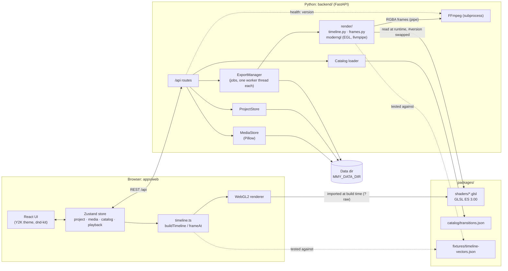
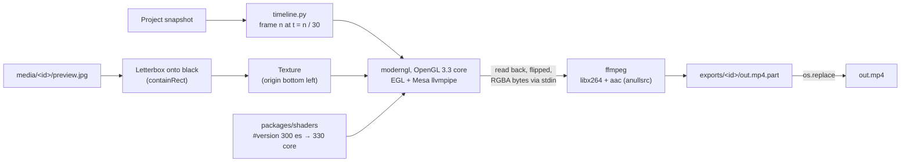
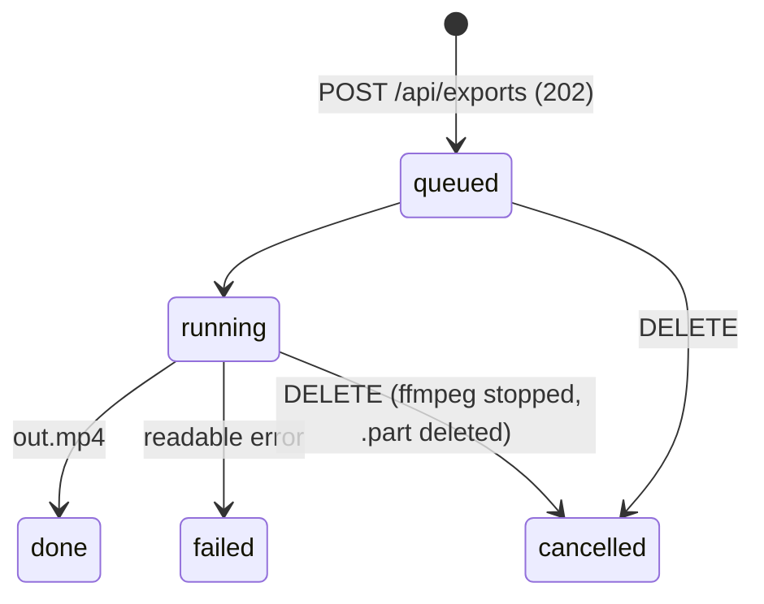

# Architecture

This document describes how moviemakerY2K is put together today (a
slideshow editor with MP4 export) and where it is heading. The reasoning behind the big
decisions lives in the ADRs:
[0001 – web app + FFmpeg backend with shared GLSL shaders](adr/0001-architecture.md)
and [0002 – Pixi for the whole repository](adr/0002-pixi.md).

## Components



| Component | Path | Responsibility |
|---|---|---|
| Web app | `apps/web/` | UI shell, media collection, storyboard, transition collection, preview player, WebGL2 renderer |
| Backend | `backend/src/mmy_backend/` | Media import and storage, catalog validation and delivery, project persistence, MP4 export (`render/`, `exports.py`), serving the built web app (`pixi run demo`) |
| Shaders | `packages/shaders/` | One GLSL ES 3.00 file per transition plus the shared prelude/epilogue/vertex shader; used by preview and export |
| Fixtures | `packages/fixtures/` | `timeline-vectors.json`: shared test vectors for the TypeScript and Python time models |
| Catalog | `packages/catalog/` | Transition metadata and parameters (single source of truth), JSON Schema |
| E2E tests | `e2e/` | Playwright tests against the real backend and the built web app |
| Scripts | `scripts/` | Dev launcher (`dev.py`), shader check, render-environment check, export benchmark, Docker export smoke test, Git hooks, Nogging tooling |

## Data flow

### 1. Upload

1. The user picks pictures in the dialog or drops them on the collection
   (native HTML5 drop; separate from dnd-kit).
2. The web app uploads them **sequentially** with `POST /api/media`
   (multipart field `files`) and shows progress.
3. The backend never trusts the content type: Pillow opens the file, applies
   `exif_transpose` and rejects anything that is not JPEG, PNG or WebP.
   Limits: 25 MB per file, 50 files per request, 40 megapixels per image
   (decompression bomb guard).
4. For each picture the backend stores the original, a thumbnail (JPEG, fits
   160×120) and a preview image (JPEG q90, longest edge ≤ 1920) under a UUID4
   hex ID. The original file name is only used for display, never as a path.
   The media index is `media.json` in the data directory.
5. The response lists a success or a readable error per file; the store adds
   the new items to the collection.

### 2. Project

- The project is one versioned JSON document (`schemaVersion: 1`):

  ```json
  {
    "schemaVersion": 1,
    "slides": [
      { "id": "s1", "mediaId": "…", "duration": 5, "transitionIn": null },
      { "id": "s2", "mediaId": "…", "duration": 5,
        "transitionIn": { "transitionId": "circle", "duration": 1.25 } }
    ]
  }
  ```

- A transition belongs to its **target** slide (`transitionIn`) and moves with
  it when slides are reordered. The first slide never has one.
- Durations: slide 0.5–60 s, transition 0.25–5 s, both in steps of 0.25 s.
  Defaults: slide 5 s, transition 1.25 s (the Movie Maker default is an
  estimate, see the research notes).
- Every change in the store triggers a **debounced autosave** (500 ms,
  `PUT /api/project`). The backend validates media IDs and transition IDs
  against the media index and the catalog; on `422` the stored project stays
  unchanged. Files are written atomically (temp file + `os.replace`) under an
  `asyncio.Lock`.
- Deleting a medium cascades: all storyboard entries using it are removed
  together with their incoming transitions.

### 3. Timeline

`apps/web/src/timeline/timeline.ts` is a pure, fully unit-tested module
without DOM or GL. The export uses a Python port of it
(`backend/src/mmy_backend/render/timeline.py`); Vitest and pytest check both
implementations against the same file,
`packages/fixtures/timeline-vectors.json` (input projects, expected segments
and time → picture/transition/progress samples, including edge cases such as
a transition longer than allowed, a single picture and hard cuts). The
playback clock stays in the browser, so the preview never depends on the
network:

- The effective transition length is
  `t_i = min(T_i, d_{i-1} / 2, d_i / 2)` (no transition → hard cut, `t = 0`).
- Slide *i* starts at `start(i-1) + d_{i-1} − t_i`; the total duration is
  `Σd − Σt`. Transitions overlap the end of the previous slide with the start
  of the next one, like in Movie Maker.
- `buildTimeline(project)` returns segments of kind `still` or `transition`;
  `frameAt(timeline, t)` says what to draw at time *t* (one picture, or two
  pictures + transition ID + progress).
- The export samples frame *n* at `t = n / fps`; a movie has
  `ceil(total duration · fps)` frames.

### 4. Renderer

- The monitor's output format is fixed at 4:3 (640×480 logical, scaled by CSS,
  DPR-aware). Every picture is letterboxed once onto black into a frame
  texture, so shaders only ever work in frame space. The export letterboxes
  with the same integer `containRect` arithmetic.
- A requestAnimationFrame clock advances playback; the renderer draws
  `frameAt(...)` each frame. A transition is drawn by the program assembled
  from the shared shader files, with the catalog parameters as uniforms.
- Shaders are imported as text at build time (Vite `?raw`), compiled once and
  cached. A shader that fails to compile falls back to Fade and is logged.
- If WebGL2 is not available, the monitor shows a notice instead; import and
  storyboard keep working.

### 5. Export



1. **Input.** Each picture is the stored `preview.jpg` (EXIF-normalised,
   longest edge ≤ 1920). It is letterboxed onto an opaque black frame of the
   output size with the browser's integer `containRect` and uploaded as a
   texture with its origin at the bottom left (like `UNPACK_FLIP_Y`). At most
   two picture textures (current and next) are held at once.
2. **Frames.** Frame *n* is drawn for `t = n / 30`. Still segments are copied
   without a shader (exactly what the preview shows at progress 0);
   transitions run the catalog entry's shader with its parameters, falling
   back to `fade` if a shader is missing or does not compile — like the
   browser.
3. **Shared shaders.** The fragment program is assembled exactly like
   `apps/web/src/render/shaderSource.ts` (prelude + transition + epilogue).
   The only change is the first line: `#version 300 es` becomes
   `#version 330 core`, because the export uses a desktop OpenGL 3.3 core
   context (the `precision` lines are legal there). The vertex shader and the
   full-screen triangle without a vertex buffer are mirrored.
4. **Headless GL.** `moderngl.create_context(standalone=True,
   backend="egl")` with Mesa's llvmpipe software renderer from the Pixi
   environment (`mesalib`, linux-64 only): no GPU, display or system
   packages. Pixi's linux-64 activation sets `__EGL_VENDOR_LIBRARY_DIRS`,
   `GLCONTEXT_LINUX_LIBEGL` and `GLCONTEXT_LINUX_LIBGL` so that glvnd finds
   the Mesa ICD and glcontext loads `libEGL`/`libGL` from the environment.
   The context is created, used and released in the export worker thread
   (EGL contexts are bound to a thread).
5. **Encoding.** The frames are read back (flipped vertically so the top row
   comes first) and piped as raw RGBA into
   `ffmpeg -f rawvideo -pix_fmt rgba -s WxH -r 30 -i -` together with a silent
   `anullsrc` audio input (48 kHz stereo, cut to the exact video length),
   encoded as `libx264 -preset medium -crf 20 -pix_fmt yuv420p -profile:v
   high -movflags +faststart` and `aac -b:a 128k`. The audio input is a
   replaceable slot for the coming music feature.
6. **Output.** FFmpeg writes `out.mp4.part`; only a complete file is renamed
   atomically to `out.mp4`. On cancel or error FFmpeg is stopped and the
   partial file deleted.

Profiles: `high` 960×720 (default) and `small` 640×480, both 30 fps.

**Platform and errors.** Linux (x86-64) is the officially supported export
platform (CI and the Docker image). On macOS and Windows moderngl tries the
native standalone context without any guarantee. If no OpenGL 3.3 context can
be created, the job ends as `failed` with a readable message (the export is
not available on this system because no OpenGL context could be created;
Linux with software rendering is supported; code `export.glUnavailable`, see
[Localisation](#localisation)) instead of crashing the backend. FFmpeg errors are reported with their first line.
`pixi run check-render-env` checks a machine: EGL/llvmpipe context, a test
frame and the FFmpeg encoders.

#### Export jobs



- **Start.** `POST /api/exports` with `{profile, fileName}` takes a
  **snapshot** of the stored project (later edits do not affect the running
  export) and checks the media references. An empty storyboard or a missing
  medium → `422`; while another export is `queued` or `running` → `409`
  (at most one export at a time). The file name is validated
  (`/\:*?"<>|`, control characters and more than 120 characters are
  rejected; a trailing `.mp4` is stripped).
- **Worker.** Each job renders in its own background thread; GL context,
  shaders and the FFmpeg process live in that thread. The status goes
  `queued → running → done | failed | cancelled` with `progress` 0..1.
- **Polling.** `GET /api/exports/{id}` returns status, progress and, for
  `failed`, `errorCode`, `errorParams` and an English `error` message. The wizard polls every 500 ms (no SSE).
- **Download.** `GET /api/exports/{id}/file` returns the MP4 with a
  `Content-Disposition` carrying the requested name (`<fileName>.mp4`, with
  an ASCII fallback and an RFC 5987 UTF-8 name). Before `done` → `409`; a
  partial file is never served.
- **Cancel / delete.** `DELETE /api/exports/{id}` cancels a queued or running
  export (FFmpeg is stopped, the partial file removed, the job stays visible
  as `cancelled`) or deletes a finished one with its file (afterwards `404`).
- **Storage and retention.** Files live in `MMY_DATA_DIR/exports/<id>/`. The
  last **5** finished exports are kept; older ones are deleted with their
  files (at most 20 job entries in total). Jobs live in memory only, so on
  startup the backend empties `exports/`, removing orphaned `.part` files and
  exports of earlier runs (logged). On shutdown running exports are
  cancelled.

## Shader contract

Each transition is one file `packages/shaders/transitions/<id>.glsl`
containing only its `uniform float` parameters and
`vec4 transition(vec2 uv)`. The renderer adds `prelude.glsl` (version header,
precision, `getFromColor`/`getToColor`, `progress`, `resolution`) and
`epilogue.glsl` (`main`). The interface follows the
[gl-transitions](https://github.com/gl-transitions/gl-transitions) pattern;
the geometry and parameters, however, are our own implementations of the
documented Movie Maker 2.x definitions.

Rules: exact source picture at `progress = 0`, exact target at `1`; no
runtime randomness (deterministic integer hashes only); pixel sizes refer to
a 640 px wide frame and scale with `resolution.x / 640.0`. Details:
[`packages/shaders/README.md`](../packages/shaders/README.md).

## Catalog

`packages/catalog/transitions.json` (validated by `transitions.schema.json`)
lists every transition with `id`, display `names` (`{"de": …, "en": …}`, both
required), `shader`,
`defaultDuration`, `params` and a `source` that records where the parameters
come from:

| id | Source | Parameters |
|---|---|---|
| `fade` | WMM 2.x XML, DXT Fade | cross-fade without black (`Overlap` 1.0) |
| `dissolve` | WMM 2.x XML, Dissolve | random pixel blocks, `blockSize` 1 [E], `seed` |
| `wipe-right` | WMM 2.x XML, "Wipe, Normal right" | `gradientSize` 0.5 |
| `circle` | SMPTE 119 "Circle, Out, Soft" | `borderSoftness` 20 px @ 640 |
| `pixelate` | WMM 2.x XML, DXT Pixelate | `maxSquare` 50 [E] |
| `checkerboard` | WMM 2.x XML, DXT CheckerBoard "Across" | `squaresX` 12, `squaresY` 10 [E] |

Values marked **[E]** (estimated) cannot be verified without a reference
installation and are listed under `source.estimated`; they can be re-tuned in
the catalog without code changes. The backend validates the catalog at
startup (an invalid catalog stops the server) and is the authority on which
transition IDs a project may use. Details:
[`packages/catalog/README.md`](../packages/catalog/README.md) and the
[research notes](research/movie-maker-reference.md).

## API

All routes live under `/api` (see `backend/src/mmy_backend/api/`). The
Pydantic models are the contract; `pixi run gen-api` writes the OpenAPI
document to `apps/web/src/generated/openapi.json` and generates
`schema.d.ts` from it, and CI fails if the checked-in files are stale.

| Method | Path | Description |
|---|---|---|
| `GET` | `/api/health` | Liveness check, including the FFmpeg version found |
| `GET` | `/api/catalog/transitions` | The transition catalog validated at startup |
| `GET` | `/api/media` | All imported media in import order |
| `POST` | `/api/media` | Upload pictures (multipart field `files`; JPEG, PNG, WebP); per-file result |
| `GET` | `/api/media/{id}/thumbnail` | Thumbnail JPEG (`Cache-Control: immutable`) |
| `GET` | `/api/media/{id}/preview` | Preview JPEG, longest edge ≤ 1920 (`Cache-Control: immutable`) |
| `DELETE` | `/api/media/{id}` | Delete a medium and cascade it out of the project; returns the updated project |
| `GET` | `/api/project` | The stored project (an empty one if none exists) |
| `PUT` | `/api/project` | Replace the project; `422` leaves the stored state unchanged |
| `POST` | `/api/exports` | Start an export of the stored project (`{profile, fileName}`); `202`, `409` while one is running, `422` for an empty project or missing media |
| `GET` | `/api/exports` | All known exports of this backend run, oldest first |
| `GET` | `/api/exports/{id}` | Status, progress and error of one export |
| `GET` | `/api/exports/{id}/file` | The finished MP4 as a download; `409` until `done` |
| `DELETE` | `/api/exports/{id}` | Cancel a running export or delete a finished one (`204`) |

Errors raised by the backend itself (media, project, export) answer with
`{"detail": {"code": "<area.error>", "params": {…}, "message": "<English>"}}`;
FastAPI's own `422` validation errors keep their list format. The web app
translates the code (see [Localisation](#localisation)); the backend has no
notion of a UI language.

With `pixi run demo`, the same process also serves the built web app at `/`.
FastAPI's interactive docs are available at `/docs` while the backend runs.

### Configuration

| Variable | Default | Meaning |
|---|---|---|
| `MMY_API_PORT` | `8000` | Port of the backend (and the Vite `/api` proxy target) |
| `MMY_DATA_DIR` | `backend/.data/` | Uploaded media, `media.json`, `project.json`, `exports/` |
| `MMY_CATALOG_DIR` | `packages/catalog/` | Where `transitions.json` is loaded from |
| `MMY_WEB_DIST` | `apps/web/dist/` | Built web app served at `/` if present |
| `MMY_SHADERS_DIR` | `packages/shaders/` | Shader files read by the export renderer |

On linux-64, Pixi's activation also sets `__EGL_VENDOR_LIBRARY_DIRS`,
`GLCONTEXT_LINUX_LIBEGL` and `GLCONTEXT_LINUX_LIBGL` to the environment's
Mesa (see `pixi.toml`). The Docker image (`backend/Dockerfile`) sets
`MMY_CATALOG_DIR`, `MMY_SHADERS_DIR` and `MMY_DATA_DIR=/data`, sources Pixi's
shell hook (which contains the EGL variables) in its entrypoint, and runs the
render environment check during the build.

## Localisation

The UI is available in German and English (OpenSpec change
`add-ui-localisation`); there is no i18n runtime library and nothing is loaded
over the network.

- **Catalogs.** `apps/web/src/i18n/en.ts` is the reference catalog, a nested
  object keyed by UI area (`menu.file.saveMovie`, `player.time`, …). Its shape
  defines the `Messages` type; `de.ts` must `satisfy` it, so a missing or
  extra key is a type error. Placeholders are written `{name}`; plural
  messages are `{ one, other }` objects chosen with `Intl.PluralRules` from a
  `count` param. A Vitest test (`i18n/t.test.ts`) additionally checks that
  both catalogs have the same keys and no empty values. Component code holds
  no visible text.
- **Locale store.** `i18n/locale.ts` picks the startup language: stored
  setting (`localStorage` key `mmy.locale`) → the first entry of
  `navigator.languages` starting with `de` or `en` → `en`. The locale lives in
  the Zustand store; `setLocale` (Tools → Options) persists it and updates
  `<html lang>`. Switching takes effect at once and leaves the project
  untouched.
- **`useT()`.** Components read `t(key, params)`, `locale`, `formatNumber` and
  `formatTime` from `i18n/useT.ts` and re-render when the locale changes.
  Numbers follow `Intl.NumberFormat`; the time display is `h:mm:ss,cc` (de) or
  `h:mm:ss.cc` (en). Duration inputs accept both `,` and `.` in either
  language.
- **Catalog names.** Transitions carry `names.de` / `names.en`; the
  collection, storyboard and dialogs show `names[locale]`.
- **Error translation.** `i18n/errors.ts` maps a backend code to the catalog
  key `errors.<code>` and fills its params (decimals formatted per locale).
  It reads the code from HTTP errors (`detail.code`), upload results
  (`error`/`errorParams`), export jobs (`errorCode`/`errorParams`) and the
  entries of FastAPI's `422` list (their `type`; anything unknown there gets a
  general "invalid input" text). Any other unknown code falls back to the
  backend's English `message`.

Unit tests run in German (`apps/web/src/test/setup.ts` stores `de`); the E2E
suite runs with browser locale `de-DE`, and `e2e/test_language_switch.py`
covers the switch to English and the browser-language detection.

## Testing strategy

| Layer | Tooling | What it covers |
|---|---|---|
| Backend | pytest + FastAPI `TestClient`, a temporary `MMY_DATA_DIR` per test | Upload validation and limits, media library, cascade delete, project validation, catalog loading, OpenAPI, export jobs (snapshot, cancel, retention, startup cleanup) |
| Export renderer | pytest under llvmpipe | Time model against the shared vectors, all six programs compile, golden boundary frames and letterboxing, MP4 streams and duration via ffprobe, PSNR of a mid-transition frame against the raw frame |
| Web | Vitest + Testing Library | Timeline maths, playback controls, store and autosave debounce, drop logic, duration parsing, shader source assembly, components |
| Shaders | `pixi run check-shaders` (glslangValidator, ES 3.00) | Every assembled program compiles; uniforms match the catalog parameters |
| E2E | Playwright (Chromium with SwiftShader for headless WebGL2), `pixi run test-e2e` | Slideshow flow in the real app; language switch and detection; export wizard incl. cancel; golden frames; preview ↔ export frame comparison |
| Docker | `scripts/docker_export_smoke.sh` (CI job `docker`) | The `prod` image builds, starts and exports a playable MP4 over the API |
| Static | Biome, Ruff, mypy (strict), TypeScript (strict) | Lint, formatting, types |

**Golden frames.** A test hook (`/?debug-progress=<id>:<p>`) renders a single
transition frame between two solid-colour pictures onto a 640×480 canvas.
The E2E suite checks for every catalog entry that progress 0 yields exactly
the source frame and progress 1 exactly the target frame, that the midpoint
differs from both, and transition-specific geometry (wipe direction, circle
growing from the centre, pixelate block size, dissolve determinism). These
tests check the consistency of our own engine; they cannot prove fidelity to
the original, for which no reference installation is available.

**Preview ↔ export.** For each of the six transitions at progress 0.5, the E2E
suite renders one frame in the browser (SwiftShader) and one with the backend
renderer from the same inputs. They must agree within 2 levels per channel on
at least 99.5 % of the pixels; bit-exact equality between SwiftShader and
llvmpipe is not realistic.

`pixi run check` is the quality gate (lint, typecheck, unit tests, shader
check, build) and runs in CI on every push and pull request, after
`pixi run check-render-env`. CI also runs the E2E suite and the Docker export
smoke test.

## Next

The next milestone is **music**: a background audio track per project. The
export already has a replaceable audio input (today the silent `anullsrc`
track), so on the export side music only changes what is fed into FFmpeg's
audio slot.
