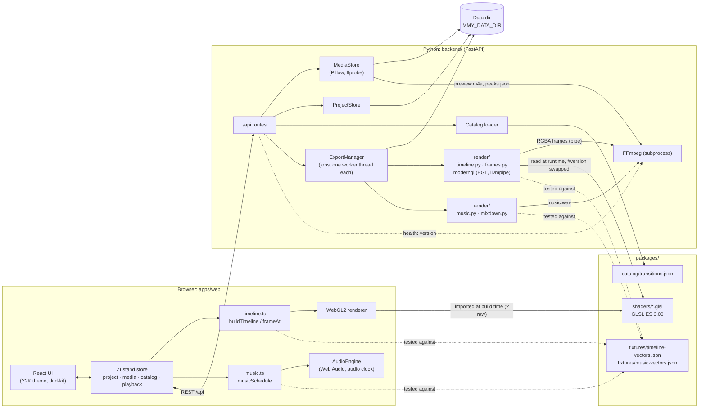
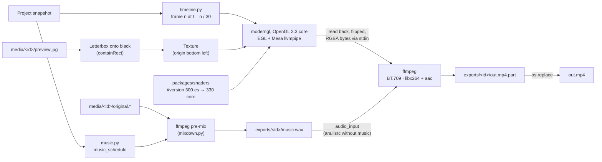
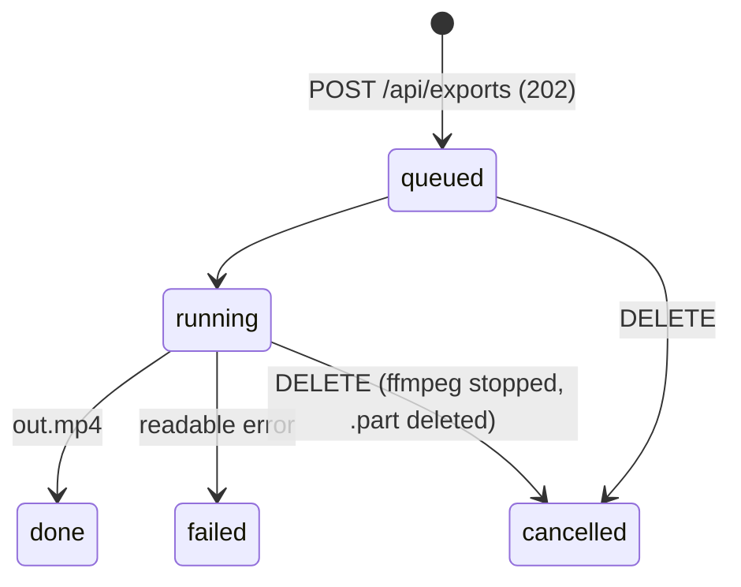

# Architecture

This document describes how moviemakerY2K is put together today (a
slideshow editor with a music track and MP4 export) and where it is heading. The reasoning behind the big
decisions lives in the ADRs:
[0001 – web app + FFmpeg backend with shared GLSL shaders](adr/0001-architecture.md)
and [0002 – Pixi for the whole repository](adr/0002-pixi.md).

## Components



| Component | Path | Responsibility |
|---|---|---|
| Web app | `apps/web/` | UI shell, collections (*My Pictures*, *My Music*, transitions), storyboard and music track, preview player, WebGL2 renderer, preview audio (`audio/AudioEngine.ts`) |
| Backend | `backend/src/mmy_backend/` | Media import and storage (pictures and audio), catalog validation and delivery, project persistence, MP4 export with music mixdown (`render/`, `exports.py`), serving the built web app (`pixi run demo`) |
| Shaders | `packages/shaders/` | One GLSL ES 3.00 file per transition and per effect plus the shared preludes/epilogues/vertex shader; used by preview and export |
| Fixtures | `packages/fixtures/` | `timeline-vectors.json` and `music-vectors.json`: shared test vectors for the TypeScript and Python time model and music schedule |
| Catalog | `packages/catalog/` | Transition and effect metadata and parameters (single source of truth), JSON Schema |
| E2E tests | `e2e/` | Playwright tests against the real backend and the built web app |
| Scripts | `scripts/` | Dev launcher (`dev.py`), shader check, render-environment check, export benchmark, Docker export smoke test, Git hooks, Nogging tooling |

## Data flow

### 1. Upload

1. The user picks pictures or audio in the dialog or drops them on the
   collection (native HTML5 drop; separate from dnd-kit). The task pane entries
   *Import pictures* and *Import audio or music* only preset the file types of
   the dialog; an audio-only import switches to *My Music*, anything else to
   *My Pictures*.
2. The web app uploads the files **sequentially** with `POST /api/media`
   (multipart field `files`) and shows progress.
3. The backend never trusts the content type or the file name; it detects
   the **media kind** by content: first Pillow (JPEG, PNG, WebP), then
   ffprobe (MP3, WAV, M4A/AAC, OGG with Vorbis or Opus, FLAC; the first audio
   stream must use one of the checked decoders). Limits per kind: pictures
   25 MB and 40 megapixels (decompression bomb guard, `exif_transpose`
   applied), audio 100 MB and 15 minutes; 50 files per request. Audio errors
   have their own codes: `media.audioTooLong`, `media.noAudioStream`, and
   `media.probeUnavailable` when ffprobe is missing.
4. Each medium gets a UUID4 hex ID and a directory `media/<id>/` with the
   unchanged original (`original.<ext>`). The original file name is only used
   for display, never as a path.
   - **Pictures:** a thumbnail (`thumb.jpg`, fits 160×120) and a preview image
     (`preview.jpg`, JPEG q90, longest edge ≤ 1920).
   - **Audio:** one FFmpeg run decodes the original once and writes both
     `preview.m4a` (AAC, 48 kHz, stereo, 128 kbit/s; a uniform format the
     browser can always decode) and mono PCM to a pipe, from which Python
     computes `peaks.json` (`{"rate": 50, "peaks": [...]}`, the largest
     absolute sample per 20 ms window, 0..1) and the **decoded** duration,
     which replaces ffprobe's container estimate and is checked against the
     15-minute limit again.
5. The media index is `media.json`, a list of entries in import order.
   `MediaItem` is a discriminated union on `kind`: `image` (`width`, `height`,
   `thumbnailUrl`, `previewUrl`), `audio` (`duration`, `sampleRate`,
   `channels`, `codec`, `audioUrl`, `peaksUrl`) or `video` (`duration`,
   `width`, `height`, `codec`, `posterUrl`, `videoUrl`). Unlike the project,
   the index has **no** `schemaVersion`: entries are self-describing and are
   migrated by shape on read, per entry and idempotently
   ([ADR 0003](adr/0003-media-index-versioning.md)) — an entry without `kind`
   was written before audio existed and is an image, and a missing `*Url` is
   rebuilt from the entry's ID, which is where it came from in the first place.
   An index that this cannot repair is a fatal `MediaIndexError` naming the
   file, never a silently empty library.
6. The response lists a success or a readable error per file; the store adds
   the new items to the collection of their kind.

### 2. Project

- The project is one versioned JSON document (`schemaVersion: 4`); `slides`
  is a discriminated union on `kind`:

  ```json
  {
    "schemaVersion": 4,
    "slides": [
      { "kind": "image", "id": "s1", "mediaId": "…", "duration": 5,
        "effectId": null, "transitionIn": null },
      { "kind": "video", "id": "s2", "mediaId": "…",
        "trimIn": 0, "trimOut": 8.5, "effectId": "sepia",
        "transitionIn": { "transitionId": "circle", "duration": 1.25 } }
    ],
    "music": [
      { "id": "m1", "mediaId": "…", "trimStart": 0, "trimEnd": null,
        "volume": 1, "fadeIn": false, "fadeOut": false }
    ]
  }
  ```

- `music` (at most 100 clips) plays gapless from 0 in list order; an `image`
  slide refers to an image and has a display `duration`; a `video` slide
  refers to a video and has no separate duration — its length is always
  `trimOut - trimIn` (`0 ≤ trimIn < trimOut ≤` the video's decoded duration);
  music clips refer to audio, and each clip's range must satisfy
  `0 ≤ trimStart < end ≤ duration` with a played length of at least 0.5 s
  (`trimEnd: null` = end of the file). Either kind of slide carries an
  `effectId` — an ID from the effect catalog or `null` for no effect, one
  effect per element, all parameters from the catalog entry.

- Older files are raised one version at a time on read: a version-1 project
  (before the music track) gains `music: []`, a version-2 project (before
  video slides) has every slide read as `kind: "image"` with its `duration`
  unchanged, and a version-3 project (before effects) gets `effectId: null`
  on every slide. Each is written at version 4 on the next save, and the API
  accepts version 4 only.

- A transition belongs to its **target** slide (`transitionIn`) and moves with
  it when slides are reordered. The first slide never has one.
- Durations: slide 0.5–60 s, transition 0.25–5 s, both in steps of 0.25 s.
  Defaults: slide 5 s, transition 1.25 s (the Movie Maker default is an
  estimate, see the research notes).
- Every change in the store triggers a **debounced autosave** (500 ms,
  `PUT /api/project`). The backend validates media IDs, transition IDs and
  effect IDs against the media index and the two catalogs; on `422` the stored
  project stays unchanged. Files are written atomically (temp file +
  `os.replace`) under an `asyncio.Lock`.
- Deleting a medium cascades: all storyboard entries using it are removed
  together with their incoming transitions, and all music clips using it are
  removed from the music track. While a `queued` or `running`
  export has the medium in its snapshot, `DELETE /api/media/{id}` answers
  `409` with `media.inUseByExport` and nothing changes; the web app removes
  the picture only after the backend confirmed the delete and otherwise shows
  the translated reason (pictures and audio alike). The in-use check and the in-memory removal happen in
  one step under the media store's lock, so an export starting at the same
  moment either makes the delete fail or fails itself with
  `export.missingMedia` — it never renders a missing picture as black.

### 3. Timeline

`apps/web/src/timeline/timeline.ts` is a pure, fully unit-tested module
without DOM or GL. The export uses a Python port of it
(`backend/src/mmy_backend/render/timeline.py`); Vitest and pytest check both
implementations against the same file,
`packages/fixtures/timeline-vectors.json` (input projects, expected segments
and time → picture/transition/progress samples, including edge cases such as
a transition longer than allowed, a single picture and hard cuts). The
playback clock stays in the browser, so the preview never depends on the
network:

- The effective transition length is
  `t_i = min(T_i, d_{i-1} / 2, d_i / 2)` (no transition → hard cut, `t = 0`).
- Slide *i* starts at `start(i-1) + d_{i-1} − t_i`; the total duration is
  `Σd − Σt`. Transitions overlap the end of the previous slide with the start
  of the next one, like in Movie Maker.
- `buildTimeline(project)` returns segments of kind `still` or `transition`;
  `frameAt(timeline, t)` says what to draw at time *t* (one picture, or two
  pictures + transition ID + progress).
- The export samples frame *n* at `t = n / fps`; a movie has
  `ceil(total duration · fps)` frames.

### 4. Music schedule

`musicSchedule(clips, mediaDurations, movieDuration)` in
`apps/web/src/timeline/music.ts` places the music on the movie time axis; the
export uses its Python port `backend/src/mmy_backend/render/music.py`. Both
are pure functions and are checked against the same file,
`packages/fixtures/music-vectors.json` (clips in a row, trimming, cut at the
movie end with the fade-out, a movie shorter than 1 s, silence after the
music). The result is a list of segments
`{mediaId, at, sourceIn, length, gain, fadeIn, fadeOut}`:

- Clips play in list order, gapless from 0; there is no start time per clip.
  A clip plays the source range `[trimStart, end)` (`end` = `trimEnd` or the
  file duration).
- `gain` is the clip volume as a linear factor (0–2, i.e. 0–200 %).
  `fadeIn`/`fadeOut` are 1 s when switched on (clipped to the segment
  length); fades are linear and multiply where they overlap.
- A clip that starts at or after the end of the movie is dropped; a clip
  running past the end is cut there. The segment that reaches the movie end
  always gets the **end-of-movie fade-out** of `min(1 s, movie duration)`.
  After the last segment the movie is silent.

The web app uses the same schedule for the music track's hint (*Music 3:12 /
Movie 2:40 – will be cut at the end*) and for *Fit Movie to Music*
(`timeline/fitToMusic.ts`): it spreads the music length evenly over the
pictures with the overlapping time model of section 3, rounds to 0.25 s,
clamps to 0.5–60 s and gives the remainder to the last picture; if the target
is out of reach, it reports the reachable minimum or maximum and changes
nothing.

### 5. Renderer

- The monitor's output format is fixed at 4:3 (640×480 logical, scaled by CSS,
  DPR-aware). Every picture is letterboxed once onto black into a frame
  texture, so shaders only ever work in frame space. The export letterboxes
  with the same integer `containRect` arithmetic.
- A requestAnimationFrame clock advances playback; the renderer draws
  `frameAt(...)` each frame. A transition is drawn by the program assembled
  from the shared shader files, with the catalog parameters as uniforms.
- An element with an `effectId` first goes through one extra pass: its own
  single-texture effect program renders into an intermediate texture (one per
  transition side, so both images can carry a different effect at once), and
  that texture feeds the still/transition pass instead of the source image.
  Without an effect the pass is skipped entirely — no copy.
- Shaders are imported as text at build time (Vite `?raw`), compiled once and
  cached. A shader that fails to compile falls back to Fade and is logged.
- If WebGL2 is not available, the monitor shows a notice instead; import and
  storyboard keep working.

### 6. Preview audio

`apps/web/src/audio/AudioEngine.ts` plays the music schedule with Web Audio;
`useMusicAudio.ts` connects it to the store.

- **Decoding.** As soon as a medium is on the music track (clip added,
  project loaded), its `preview.m4a` is fetched and decoded once in an
  `OfflineAudioContext` (no user gesture needed) and cached per medium.
- **Playback.** Each segment becomes an `AudioBufferSourceNode` → `GainNode`
  started at its movie time with `start(when, sourceIn + offset, …)`; volume
  and fades are linear gain ramps. Every change of the plan — play, pause,
  stop, seek, a project or music edit — stops all sources and schedules again
  from the current movie time.
- **Audio clock.** While music is scheduled and the `AudioContext` runs,
  `clockTime()` derives the movie time from `AudioContext.currentTime`, and
  the player's requestAnimationFrame loop advances playback by that clock
  instead of its own frame delta. Picture and sound therefore cannot drift
  apart; without music (or without a running context) the rAF clock is
  used as before.
- **Autoplay policy.** The `AudioContext` is created or resumed only inside a
  user gesture: the play button, the space bar, or any pointer/key event while
  the project has music.
- The transition sample of the collection is silent. `preview.m4a` carries
  the usual AAC priming delay (20–45 ms), so the preview is not sample-exact;
  the export mixes from the originals instead.
- Web Audio is injected (`AudioEngineDeps`), so the unit tests drive the
  engine with a fake `AudioContext`. `window.__mmyAudio()` exposes the engine
  state (context state, clock master, active sources, decoded media) to the
  E2E tests.

### 7. Export



1. **Music pre-mix.** If the project has music, a separate FFmpeg run first
   mixes it into `exports/<id>/music.wav` (48 kHz stereo, 32-bit float),
   exactly as long as the video (`frames / 30` s). Input is each clip's
   **original** file (not `preview.m4a`), placed by `music_schedule` with the
   timeline's movie duration — the same placement as in the preview. Per
   segment the filter chain is `aresample=48000, aformat=fltp/stereo,
   atrim, asetpts, volume, afade (in/out), adelay`; the segments are summed
   with `amix=normalize=0` (they never overlap, so each keeps its gain), then
   `apad` + `atrim` pad with silence or cut to the exact sample count.
   Cancellation is checked while FFmpeg runs; a mixing error fails the job
   with `export.audioFailed`. `music.wav` is deleted when the job ends.
   Without music (or if no segment falls into the movie) the silent
   `anullsrc` input is used.
2. **Input.** Each picture is the stored `preview.jpg` (EXIF-normalised,
   longest edge ≤ 1920). It is letterboxed onto an opaque black frame of the
   output size with the browser's integer `containRect` and uploaded as a
   texture with its origin at the bottom left (like `UNPACK_FLIP_Y`). At most
   two picture textures (current and next) are held at once.
3. **Frames.** Frame *n* is drawn for `t = n / 30`. Still segments of an
   element without an effect are copied without a shader (exactly what the
   preview shows at progress 0); transitions run the catalog entry's shader
   with its parameters, falling back to `fade` if a shader is missing or does
   not compile — like the browser. An element with an `effectId` runs the
   effect pass first (same shader files, same intermediate-texture scheme as
   the preview), which also sends its still frames through GL: the fade
   program at progress 0 on the effect's result.
4. **Shared shaders.** The fragment program is assembled exactly like
   `apps/web/src/render/shaderSource.ts` (prelude + transition + epilogue).
   The only change is the first line: `#version 300 es` becomes
   `#version 330 core`, because the export uses a desktop OpenGL 3.3 core
   context (the `precision` lines are legal there). The vertex shader and the
   full-screen triangle without a vertex buffer are mirrored.
5. **Headless GL.** `moderngl.create_context(standalone=True,
   backend="egl")` with Mesa's llvmpipe software renderer from the Pixi
   environment (`mesalib`, for both Linux targets `linux-64` and
   `linux-aarch64`): no GPU, display or system packages. Pixi's Linux
   activation sets `__EGL_VENDOR_LIBRARY_DIRS`, `GLCONTEXT_LINUX_LIBEGL` and
   `GLCONTEXT_LINUX_LIBGL` so that glvnd finds the Mesa ICD and glcontext
   loads `libEGL`/`libGL` from the environment, plus
   `LIBGL_ALWAYS_SOFTWARE=1` so that Mesa actually picks llvmpipe instead of
   auto-detecting a host GPU driver it cannot load (on `linux-aarch64` it would
   otherwise select the Raspberry Pi's `v3d` and fail with `eglInitialize
   failed` rather than fall back). `render/context.py` passes
   these library paths to glcontext explicitly (falling back to
   `sys.prefix/lib`), because glcontext would otherwise call
   `ctypes.util.find_library` first and spawn `ldconfig`/`gcc` for every
   context.
   The context is created, used and released in the export worker thread
   (EGL contexts are bound to a thread).
6. **Encoding.** The frames are read back (flipped vertically so the top row
   comes first) and piped as raw RGBA into
   `ffmpeg -f rawvideo -pix_fmt rgba -s WxH -r 30 -i -` together with the
   audio input — `music.wav`, or a silent `anullsrc` (48 kHz stereo) without
   music — cut to the exact video length and encoded as `libx264 -preset
   medium -crf 20 -pix_fmt yuv420p -profile:v high -movflags +faststart` and
   `aac -b:a 128k` (48 kHz stereo). A gain above 100 % is only clipped here,
   by the AAC encoder.
   **Colour space:** the filter
   `scale=out_color_matrix=bt709:out_range=tv,format=yuv420p,setparams=…`
   converts RGB → YUV with the BT.709 matrix in limited range (swscale would
   otherwise use BT.601), and `-colorspace bt709 -color_primaries bt709
   -color_trc bt709 -color_range tv` tags the stream. `setparams` is needed
   because FFmpeg takes the frames' colour properties over the encoder
   options; without it primaries and transfer would stay `unknown`. BT.709
   is what browsers and players assume for HD material, so preview and movie
   match in colour.
7. **Output.** FFmpeg writes `out.mp4.part`; only a complete file is renamed
   atomically to `out.mp4`. On cancel or error FFmpeg is stopped and the
   partial file deleted.

Profiles: `high` 960×720 (default) and `small` 640×480, both 30 fps.

**Platform and errors.** Linux is the officially supported export platform:
x86-64 (CI and the Docker image) and aarch64 (e.g. a Raspberry Pi;
`linux-aarch64` is a Pixi platform with the same Mesa/EGL setup). The CI job
`render-arm64` runs `check-render-env` and the backend render/export tests on
`ubuntu-24.04-arm`; hosted ARM runners are free only for public
repositories, so the job is skipped while the repository is private and
aarch64 is verified by a manual run on a Raspberry Pi instead. On macOS and Windows moderngl tries the
native standalone context without any guarantee. If no OpenGL 3.3 context can
be created, the job ends as `failed` with a readable message (the export is
not available on this system because no OpenGL context could be created;
Linux with software rendering is supported; code `export.glUnavailable`, see
[Localisation](#localisation)) instead of crashing the backend. FFmpeg errors are reported with their first line.
`pixi run check-render-env` checks a machine: EGL/llvmpipe context, a test
frame and the FFmpeg encoders.

#### Export jobs



- **Start.** `POST /api/exports` with `{profile, fileName}` takes a
  **snapshot** of the stored project (later edits do not affect the running
  export) and checks the media references. An empty storyboard, a missing
  picture (`export.missingMedia`) or missing music media
  (`export.missingMusicMedia`) → `422`; while another export is `queued` or `running` → `409`
  (at most one export at a time). The file name is validated
  (`/\:*?"<>|`, control characters and more than 120 characters are
  rejected; a trailing `.mp4` is stripped).
- **Worker.** Each job renders in its own background thread; GL context,
  shaders and the FFmpeg process live in that thread. The status goes
  `queued → running → done | failed | cancelled` with `progress` 0..1.
- **Polling.** `GET /api/exports/{id}` returns status, progress and, for
  `failed`, `errorCode`, `errorParams` and an English `message`. The wizard polls every 500 ms (no SSE).
- **Download.** `GET /api/exports/{id}/file` returns the MP4 with a
  `Content-Disposition` carrying the requested name (`<fileName>.mp4`, with
  an ASCII fallback and an RFC 5987 UTF-8 name). Before `done` → `409`; a
  partial file is never served.
- **Cancel / delete.** `DELETE /api/exports/{id}` cancels a queued or running
  export (FFmpeg is stopped, the partial file removed, the job stays visible
  as `cancelled`) or deletes a finished one with its file (afterwards `404`).
- **Storage and retention.** Files live in `MMY_DATA_DIR/exports/<id>/`. The
  last **5** finished exports are kept; older ones are deleted with their
  files (at most 20 job entries in total). A job switches to `done` and
  retention is applied in one step under the same lock, so the list never
  shows more than five finished exports.
- **Job index.** Finished exports are listed in `exports/index.json`
  (`id`, `fileName`, `profile`, `createdAt`), written atomically (temp file +
  `os.replace`) whenever that set changes. On startup the backend loads the
  entries whose `out.mp4` exists as `done` jobs and removes everything else
  under `exports/` — partial files, orphaned directories, jobs without a
  file (logged). A damaged index is logged and treated as empty. Queued,
  running, failed and cancelled jobs live in memory only; on shutdown running
  exports are cancelled.

## Shader contract

Each transition is one file `packages/shaders/transitions/<id>.glsl`
containing only its `uniform float` parameters and
`vec4 transition(vec2 uv)`. The renderer adds `prelude.glsl` (version header,
precision, `getFromColor`/`getToColor`, `progress`, `resolution`) and
`epilogue.glsl` (`main`). The interface follows the
[gl-transitions](https://github.com/gl-transitions/gl-transitions) pattern;
the geometry and parameters, however, are our own implementations of the
documented Movie Maker 2.x definitions.

Rules: exact source picture at `progress = 0`, exact target at `1`; no
runtime randomness (deterministic integer hashes only); pixel sizes refer to
a 640 px wide frame and scale with `resolution.x / 640.0`. Details:
[`packages/shaders/README.md`](../packages/shaders/README.md).

## Catalog

`packages/catalog/transitions.json` (validated by `transitions.schema.json`)
lists every transition with `id`, display `names` (`{"de": …, "en": …}`, both
required), `shader`,
`defaultDuration`, `params` and a `source` that records where the parameters
come from:

| id | Source | Parameters |
|---|---|---|
| `fade` | WMM 2.x XML, DXT Fade | cross-fade without black (`Overlap` 1.0) |
| `dissolve` | WMM 2.x XML, Dissolve | random pixel blocks, `blockSize` 1 [E], `seed` |
| `wipe-right` | WMM 2.x XML, "Wipe, Normal right" | `gradientSize` 0.5 |
| `circle` | SMPTE 119 "Circle, Out, Soft" | `borderSoftness` 20 px @ 640 |
| `pixelate` | WMM 2.x XML, DXT Pixelate | `maxSquare` 50 [E] |
| `checkerboard` | WMM 2.x XML, DXT CheckerBoard "Across" | `squaresX` 12, `squaresY` 10 [E] |

Values marked **[E]** (estimated) cannot be verified without a reference
installation and are listed under `source.estimated`; they can be re-tuned in
the catalog without code changes. The backend validates the catalog at
startup (an invalid catalog stops the server) and is the authority on which
transition IDs a project may use. Details:
[`packages/catalog/README.md`](../packages/catalog/README.md) and the
[research notes](research/movie-maker-reference.md).

## API

All routes live under `/api` (see `backend/src/mmy_backend/api/`). The
Pydantic models are the contract; `pixi run gen-api` writes the OpenAPI
document to `apps/web/src/generated/openapi.json` and generates
`schema.d.ts` from it, and CI fails if the checked-in files are stale.

| Method | Path | Description |
|---|---|---|
| `GET` | `/api/health` | Liveness check, including the FFmpeg version found |
| `GET` | `/api/catalog/transitions` | The transition catalog validated at startup |
| `GET` | `/api/catalog/effects` | The effect catalog validated at startup |
| `GET` | `/api/media` | All imported media in import order |
| `POST` | `/api/media` | Upload pictures and audio (multipart field `files`; JPEG, PNG, WebP, MP3, WAV, M4A/AAC, OGG, FLAC); per-file result |
| `GET` | `/api/media/{id}/thumbnail` | Thumbnail JPEG (`Cache-Control: immutable`) |
| `GET` | `/api/media/{id}/preview` | Preview JPEG, longest edge ≤ 1920 (`Cache-Control: immutable`) |
| `GET` | `/api/media/{id}/audio` | Audio preview version, AAC 48 kHz stereo in M4A (`Cache-Control: immutable`) |
| `GET` | `/api/media/{id}/peaks` | Waveform data `{rate: 50, peaks}` (`Cache-Control: immutable`) |
| `DELETE` | `/api/media/{id}` | Delete a medium and cascade it out of the project; returns the updated project; `409` (`media.inUseByExport`) while a queued or running export uses it |
| `GET` | `/api/project` | The stored project (an empty one if none exists) |
| `PUT` | `/api/project` | Replace the project (`schemaVersion` 4 with `slides` and `music`); `422` leaves the stored state unchanged |
| `POST` | `/api/exports` | Start an export of the stored project (`{profile, fileName}`); `202`, `409` while one is running, `422` for an empty project or missing media |
| `GET` | `/api/exports` | All known exports, oldest first (finished ones also from earlier runs) |
| `GET` | `/api/exports/{id}` | Status, progress and error of one export |
| `GET` | `/api/exports/{id}/file` | The finished MP4 as a download; `409` until `done` |
| `DELETE` | `/api/exports/{id}` | Cancel a running export or delete a finished one (`204`) |

**Error contract.** Errors raised by the backend itself (media, project,
export) answer with
`{"detail": {"code": "<area.error>", "params": {…}, "message": "<English>"}}`;
FastAPI's own `422` validation errors keep their list format (`type` = code,
`ctx` = params, `msg` = English message). Failed upload results and export
jobs carry the same information as `errorCode`, `errorParams` and `message`.
All codes are members of the `StrEnum` `ErrorCode`
(`backend/src/mmy_backend/errors.py`), which OpenAPI exposes as an enum on
`ApiError.code` and `errorCode`; a code is never renamed, only added. The web app
translates the code (see [Localisation](#localisation)); the backend has no
notion of a UI language.

With `pixi run demo`, the same process also serves the built web app at `/`.
FastAPI's interactive docs are available at `/docs` while the backend runs.

### Configuration

| Variable | Default | Meaning |
|---|---|---|
| `MMY_API_PORT` | `8000` | Port of the backend (and the Vite `/api` proxy target) |
| `MMY_DATA_DIR` | `backend/.data/` | Uploaded media, `media.json`, `project.json`, `exports/` |
| `MMY_CATALOG_DIR` | `packages/catalog/` | Where `transitions.json` and `effects.json` are loaded from |
| `MMY_WEB_DIST` | `apps/web/dist/` | Built web app served at `/` if present |
| `MMY_SHADERS_DIR` | `packages/shaders/` | Shader files read by the export renderer |

On Linux, Pixi's activation also sets `__EGL_VENDOR_LIBRARY_DIRS`,
`GLCONTEXT_LINUX_LIBEGL` and `GLCONTEXT_LINUX_LIBGL` to the environment's
Mesa, and `LIBGL_ALWAYS_SOFTWARE=1` to pin llvmpipe (see `pixi.toml`). The Docker image (`backend/Dockerfile`) sets
`MMY_CATALOG_DIR`, `MMY_SHADERS_DIR` and `MMY_DATA_DIR=/data`, sources Pixi's
shell hook (which contains the EGL variables) in its entrypoint, and runs the
render environment check during the build.

## Layout modes and touch

One React app serves desktop, tablet and phone; only the shell and the input
model change, the store, time model and API stay the same
(OpenSpec change `add-mobile-layout`).

**Layout modes.** `apps/web/src/shell/layoutMode.ts` holds the only
breakpoints and `useLayoutMode()`, which derives the mode from `matchMedia`:

| Mode | Condition | Shell |
|---|---|---|
| `wide` | width ≥ 1280 px | `AppWindow` — the Movie Maker window (task pane, status bar) |
| `medium` | 600–1279 px | `AppWindow variant="medium"` — collection and monitor side by side, taskbar instead of task pane and status bar |
| `compact` | width < 600 px, or landscape with height < 500 px | `CompactWindow` — title bar with *☰*, monitor (≤ 45 % height), storyboard and music track, action bar, taskbar; landscape puts the monitor left |

The root element mirrors the result as `data-layout`, `data-orientation` and
`data-pointer` (`coarse` for touch screens); CSS keys mode-specific rules on
these attributes, and `theme.css` adds touch, taskbar, sheet and safe-area
tokens (`--y2k-touch-target: 44px`, `--y2k-safe-*` from
`env(safe-area-inset-*)`). With a coarse pointer or in the compact layout every
interactive element is at least 44 × 44 px. Switching modes keeps the store
untouched, so project, selection and playback survive a rotation.

**Touch operation** (`isTouchLayout`: coarse pointer or compact) replaces
hover, double click, right click and dragging, never adding a second editing
logic:

- **Task groups as data.** `shell/tasks.ts` describes the three task groups
  (label, icon, action, activation). The desktop task pane and the taskbar's
  step sheets render the same entries; in the compact layout the collection
  entries also open the collection sheet.
- **Sheets.** `ui/Sheet.tsx` is a modal bottom sheet on `<dialog>` (grip,
  `auto`/`full` height, close via button, Escape, backdrop and swipe down,
  focus trap and return through the shared `useModal` hook, reduced motion).
  `Dialog` renders as a sheet in the compact layout, and `ContextMenu`
  renders as an action sheet with touch operation, so existing dialogs and
  menus follow without changes of their own. `MenuSheet` shows the menus of
  `menus.ts` behind *☰*.
- **Selection and actions.** A tap selects (store `selection` /
  `musicSelection`). `ActionBar` offers the element's actions; they call the
  store functions the desktop uses (`moveSlide`, `removeSlide`,
  `updateMusicClip` …) or raise an **edit request** (`requestEdit`, like
  `requestImport`): the storyboard strip and music track own their dialogs
  and context menus and open them for a request, a long press
  (`ui/useLongPress`, 400 ms within 8 px) or the *⋯* button.
- **Picking.** `media/CollectionSheet` hosts `MediaCollection` in picking
  mode (tap toggles, order kept, no draggable) and inserts the picks with
  `addSlide`/`addMusicClip`.
- **Dragging.** `StoryboardDnd` uses two sensors: the pointer sensor for
  mouse and pen (5 px) and a `TouchSensor` that activates after a 400 ms press
  within 8 px, so a swipe scrolls the strip. Both release dnd-kit's click
  guard at the next press (mmy-fa5). Only the dragged item switches to
  `touch-action: none`; the strips contain their overscroll.
- **Transitions** are set in `transitions/TransitionSheet` (catalog list,
  stepper); `playTransitionOnce` plays the slot once in the monitor by
  playing up to `Playback.until`.
- **Gestures and haptics.** `ui/useGestures` (swipe, double tap) and
  `ui/usePinch` read Pointer Events directly, without a library;
  `player/useFullscreen` uses the Fullscreen API on the monitor container or
  a fixed overlay. `ui/haptics` wraps `navigator.vibrate` behind the stored
  *Vibration* option.

**Performance.** The preview buffer is the CSS size × min(devicePixelRatio, 2)
and at most 1920 px wide (`previewBufferSize`); a hidden tab pauses playback,
which stops the rAF clock. Thumbnails load lazily and decode asynchronously.

## Localisation

The UI is available in German and English (OpenSpec change
`add-ui-localisation`); there is no i18n runtime library and nothing is loaded
over the network.

- **Catalogs.** `apps/web/src/i18n/en.ts` is the reference catalog, a nested
  object keyed by UI area (`menu.file.saveMovie`, `player.time`, …). Its shape
  defines the `Messages` type; `de.ts` must `satisfy` it, so a missing or
  extra key is a type error. Placeholders are written `{name}`; plural
  messages are `{ one, other }` objects chosen with `Intl.PluralRules` from a
  `count` param. A Vitest test (`i18n/t.test.ts`) additionally checks that
  both catalogs have the same keys and no empty values. Component code holds
  no visible text.
- **Locale store.** `i18n/locale.ts` picks the startup language: stored
  setting (`localStorage` key `mmy.locale`) → the first entry of
  `navigator.languages` starting with `de` or `en` → `en`. The locale lives in
  the Zustand store; `setLocale` (Tools → Options) persists it and updates
  `<html lang>`. Switching takes effect at once and leaves the project
  untouched. A small dependency-free inline script in `apps/web/index.html`
  applies the same rule before the app bundle runs, so `<html lang>` is
  right from the first paint (a unit test keeps both rules in sync).
- **`useT()`.** Components read `t(key, params)`, `locale`, `formatNumber` and
  `formatTime` from `i18n/useT.ts` and re-render when the locale changes.
  Numbers follow `Intl.NumberFormat`; the time display is `h:mm:ss,cc` (de) or
  `h:mm:ss.cc` (en). Duration inputs accept both `,` and `.` in either
  language.
- **Catalog names.** Transitions carry `names.de` / `names.en`; the
  collection, storyboard and dialogs show `names[locale]`.
- **Error translation.** `i18n/errors.ts` maps a backend code to the catalog
  key `errors.<code>` and fills its params (decimals formatted per locale).
  The `errors` catalog is keyed by the generated `ErrorCode` union, so a code
  without a text is a type error (`pixi run typecheck`). It reads the code
  from HTTP errors (`detail.code`), upload results and export jobs
  (`errorCode`/`errorParams`/`message`) and the entries of FastAPI's `422`
  list (their `type`; anything unknown there gets a general "invalid input"
  text). A `422` entry whose `loc` is `["body","slides",<i>,…]` is prefixed
  with the picture number *i + 1* (`errors.atPicture`: "Picture 2: …" /
  "Bild 2: …"). Any other unknown code falls back to the backend's English
  `message`.
- **Accessible names.** The dialog title-bar button is named "Close dialog"
  ("Dialog schließen"), so no dialog has two buttons called "Close".

Unit tests run in German (`apps/web/src/test/setup.ts` stores `de`); the E2E
suite runs with browser locale `de-DE`, and `e2e/test_language_switch.py`
covers the switch to English and the browser-language detection.

## Testing strategy

| Layer | Tooling | What it covers |
|---|---|---|
| Backend | pytest + FastAPI `TestClient`, a temporary `MMY_DATA_DIR` per test | Upload validation and limits, audio import per format (generated MP3, WAV, M4A, OGG, FLAC) incl. too long and no audio stream, audio preview format and peaks length, media library, project schema v2 and the v1 migration, startup against a pre-0.2.0 media index (migration by shape), music clip validation, cascade delete and the in-use `409`, project validation, catalog loading, OpenAPI incl. the `ErrorCode` enum, export jobs (snapshot, cancel, retention, job index across restarts, damaged index) |
| Export renderer | pytest under llvmpipe | Time model and music schedule against the shared vectors, music pre-mix (length = video length, audible level, end fade-out, fade-in, 50 % volume, silence after short music) via ffprobe and `astats`, all six programs compile, golden boundary frames and letterboxing, MP4 streams, duration and BT.709 colour tags via ffprobe, red/blue round trip within 3 levels, PSNR of a mid-transition frame (decoded as BT.709), context creation without subprocesses |
| Web | Vitest + Testing Library; `mockLayout()`/`mockViewport()` fake `matchMedia` for the layout modes | Layout modes at every boundary, compact/medium shells, sheets, taskbar, menu sheet, action bar and action sheets, collection sheet, touch reordering, transition sheet, steppers, gestures, full screen, tile size, haptics, preview buffer limits; timeline maths, music schedule (shared vectors), *Fit Movie to Music*, `AudioEngine` with a fake `AudioContext` (start time, offset after seek, pause, mute), music collection and music track, playback controls, store and autosave debounce, drop logic, duration parsing, shader source assembly, components |
| Shaders | `pixi run check-shaders` (glslangValidator, ES 3.00) | Every assembled program compiles; uniforms match the catalog parameters |
| E2E | Playwright (Chromium with SwiftShader for headless WebGL2), `pixi run test-e2e` | Device profiles iPhone 13, Pixel 7 and iPad (gen 7) with touch: no horizontal scroll, 44 px targets, the whole flow by tapping in portrait and landscape (`e2e/test_mobile.py`); slideshow flow in the real app; LAN mode with access token, token link, cookie and manifest (`e2e/test_lan_mode.py`); language switch and detection; export wizard incl. cancel; music flow (generated melody → *My Music* → music track → export with an AAC 48 kHz stereo track as long as the video, audible and fading out); golden frames; preview ↔ export frame comparison |
| Docker | `scripts/docker_export_smoke.sh` (CI job `docker`) | The `prod` image builds, starts and exports a playable MP4 over the API |
| Static | Biome, Ruff (backend, `e2e/`, `scripts/`), mypy (strict), TypeScript (strict) | Lint, formatting, types |

**Golden frames.** A test hook (`/?debug-progress=<id>:<p>`) renders a single
transition frame between two solid-colour pictures onto a 640×480 canvas.
The E2E suite checks for every catalog entry that progress 0 yields exactly
the source frame and progress 1 exactly the target frame, that the midpoint
differs from both, and transition-specific geometry (wipe direction, circle
growing from the centre, pixelate block size, dissolve determinism). These
tests check the consistency of our own engine; they cannot prove fidelity to
the original, for which no reference installation is available.

**Preview ↔ export.** For each of the six transitions at progress 0.5, the E2E
suite renders one frame in the browser (SwiftShader) and one with the backend
renderer from the same inputs. They must agree within 2 levels per channel on
at least 99.5 % of the pixels; bit-exact equality between SwiftShader and
llvmpipe is not realistic. Because solid colours say little about Pixelate
and Dissolve, `?debug-progress=<id>:<p>:pattern` renders a built-in, exactly
640×480 test pattern (integer ramps and checkerboards, no scaling;
`apps/web/src/render/testPattern.ts`). `e2e/test_export_golden_pattern.py`
builds the same pattern in Python, checks exact equality at progress 0 and 1
and compares Pixelate and Dissolve at 0.25, 0.5 and 0.75 with the same
tolerance.

`pixi run check` is the quality gate (lint, typecheck, unit tests, shader
check, build) and runs in CI on every push and pull request, after
`pixi run check-render-env`. CI also runs the E2E suite, the Docker export
smoke test and (for public repositories) the `render-arm64` job.

## Next

Music is a list of pieces played one after another; a timeline view with
freely placed audio clips, clip sound, narration and audio levels are not
built yet (see the roadmap in the README). The music schedule and the
pre-mix are the places where such features would plug in.
