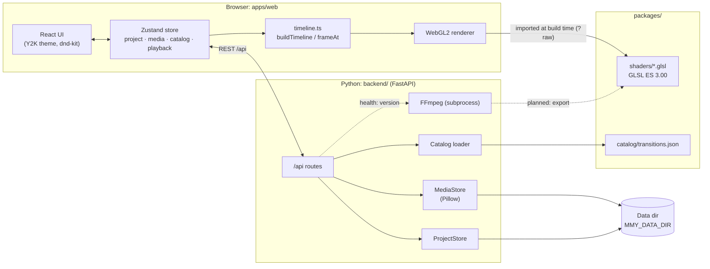

# Architecture

This document describes how moviemakerY2K is put together today (the
slideshow prototype) and where it is heading. The reasoning behind the big
decisions lives in the ADRs:
[0001 – web app + FFmpeg backend with shared GLSL shaders](adr/0001-architecture.md)
and [0002 – Pixi for the whole repository](adr/0002-pixi.md).

## Components



| Component | Path | Responsibility |
|---|---|---|
| Web app | `apps/web/` | UI shell, media collection, storyboard, transition collection, preview player, WebGL2 renderer |
| Backend | `backend/src/mmy_backend/` | Media import and storage, catalog validation and delivery, project persistence, serving the built web app (`pixi run demo`) |
| Shaders | `packages/shaders/` | One GLSL ES 3.00 file per transition plus the shared prelude/epilogue/vertex shader |
| Catalog | `packages/catalog/` | Transition metadata and parameters (single source of truth), JSON Schema |
| E2E tests | `e2e/` | Playwright tests against the real backend and the built web app |
| Scripts | `scripts/` | Dev launcher (`dev.py`), shader check, Git hooks, Nogging tooling |

## Data flow

### 1. Upload

1. The user picks pictures in the dialog or drops them on the collection
   (native HTML5 drop; separate from dnd-kit).
2. The web app uploads them **sequentially** with `POST /api/media`
   (multipart field `files`) and shows progress.
3. The backend never trusts the content type: Pillow opens the file, applies
   `exif_transpose` and rejects anything that is not JPEG, PNG or WebP.
   Limits: 25 MB per file, 50 files per request, 40 megapixels per image
   (decompression bomb guard).
4. For each picture the backend stores the original, a thumbnail (JPEG, fits
   160×120) and a preview image (JPEG q90, longest edge ≤ 1920) under a UUID4
   hex ID. The original file name is only used for display, never as a path.
   The media index is `media.json` in the data directory.
5. The response lists a success or a readable error per file; the store adds
   the new items to the collection.

### 2. Project

- The project is one versioned JSON document (`schemaVersion: 1`):

  ```json
  {
    "schemaVersion": 1,
    "slides": [
      { "id": "s1", "mediaId": "…", "duration": 5, "transitionIn": null },
      { "id": "s2", "mediaId": "…", "duration": 5,
        "transitionIn": { "transitionId": "circle", "duration": 1.25 } }
    ]
  }
  ```

- A transition belongs to its **target** slide (`transitionIn`) and moves with
  it when slides are reordered. The first slide never has one.
- Durations: slide 0.5–60 s, transition 0.25–5 s, both in steps of 0.25 s.
  Defaults: slide 5 s, transition 1.25 s (the Movie Maker default is an
  estimate, see the research notes).
- Every change in the store triggers a **debounced autosave** (500 ms,
  `PUT /api/project`). The backend validates media IDs and transition IDs
  against the media index and the catalog; on `422` the stored project stays
  unchanged. Files are written atomically (temp file + `os.replace`) under an
  `asyncio.Lock`.
- Deleting a medium cascades: all storyboard entries using it are removed
  together with their incoming transitions.

### 3. Timeline

`apps/web/src/timeline/timeline.ts` is a pure, fully unit-tested module
without DOM or GL, so that the later export can compute exactly the same
timing:

- The effective transition length is
  `t_i = min(T_i, d_{i-1} / 2, d_i / 2)` (no transition → hard cut, `t = 0`).
- Slide *i* starts at `start(i-1) + d_{i-1} − t_i`; the total duration is
  `Σd − Σt`. Transitions overlap the end of the previous slide with the start
  of the next one, like in Movie Maker.
- `buildTimeline(project)` returns segments of kind `still` or `transition`;
  `frameAt(timeline, t)` says what to draw at time *t* (one picture, or two
  pictures + transition ID + progress).

### 4. Renderer

- The monitor's output format is fixed at 4:3 (640×480 logical, scaled by CSS,
  DPR-aware). Every picture is letterboxed once onto black into a frame
  texture, so shaders only ever work in frame space — just like the planned
  export after FFmpeg scale + pad.
- A requestAnimationFrame clock advances playback; the renderer draws
  `frameAt(...)` each frame. A transition is drawn by the program assembled
  from the shared shader files, with the catalog parameters as uniforms.
- Shaders are imported as text at build time (Vite `?raw`), compiled once and
  cached. A shader that fails to compile falls back to Fade and is logged.
- If WebGL2 is not available, the monitor shows a notice instead; import and
  storyboard keep working.

## Shader contract

Each transition is one file `packages/shaders/transitions/<id>.glsl`
containing only its `uniform float` parameters and
`vec4 transition(vec2 uv)`. The renderer adds `prelude.glsl` (version header,
precision, `getFromColor`/`getToColor`, `progress`, `resolution`) and
`epilogue.glsl` (`main`). The interface follows the
[gl-transitions](https://github.com/gl-transitions/gl-transitions) pattern;
the geometry and parameters, however, are our own implementations of the
documented Movie Maker 2.x definitions.

Rules: exact source picture at `progress = 0`, exact target at `1`; no
runtime randomness (deterministic integer hashes only); pixel sizes refer to
a 640 px wide frame and scale with `resolution.x / 640.0`. Details:
[`packages/shaders/README.md`](../packages/shaders/README.md).

## Catalog

`packages/catalog/transitions.json` (validated by `transitions.schema.json`)
lists every transition with `id`, display `name`, `shader`,
`defaultDuration`, `params` and a `source` that records where the parameters
come from:

| id | Source | Parameters |
|---|---|---|
| `fade` | WMM 2.x XML, DXT Fade | cross-fade without black (`Overlap` 1.0) |
| `dissolve` | WMM 2.x XML, Dissolve | random pixel blocks, `blockSize` 1 [E], `seed` |
| `wipe-right` | WMM 2.x XML, "Wipe, Normal right" | `gradientSize` 0.5 |
| `circle` | SMPTE 119 "Circle, Out, Soft" | `borderSoftness` 20 px @ 640 |
| `pixelate` | WMM 2.x XML, DXT Pixelate | `maxSquare` 50 [E] |
| `checkerboard` | WMM 2.x XML, DXT CheckerBoard "Across" | `squaresX` 12, `squaresY` 10 [E] |

Values marked **[E]** (estimated) cannot be verified without a reference
installation and are listed under `source.estimated`; they can be re-tuned in
the catalog without code changes. The backend validates the catalog at
startup (an invalid catalog stops the server) and is the authority on which
transition IDs a project may use. Details:
[`packages/catalog/README.md`](../packages/catalog/README.md) and the
[research notes](research/movie-maker-reference.md).

## API

All routes live under `/api` (see `backend/src/mmy_backend/api/`). The
Pydantic models are the contract; `pixi run gen-api` writes the OpenAPI
document to `apps/web/src/generated/openapi.json` and generates
`schema.d.ts` from it, and CI fails if the checked-in files are stale.

| Method | Path | Description |
|---|---|---|
| `GET` | `/api/health` | Liveness check, including the FFmpeg version found |
| `GET` | `/api/catalog/transitions` | The transition catalog validated at startup |
| `GET` | `/api/media` | All imported media in import order |
| `POST` | `/api/media` | Upload pictures (multipart field `files`; JPEG, PNG, WebP); per-file result |
| `GET` | `/api/media/{id}/thumbnail` | Thumbnail JPEG (`Cache-Control: immutable`) |
| `GET` | `/api/media/{id}/preview` | Preview JPEG, longest edge ≤ 1920 (`Cache-Control: immutable`) |
| `DELETE` | `/api/media/{id}` | Delete a medium and cascade it out of the project; returns the updated project |
| `GET` | `/api/project` | The stored project (an empty one if none exists) |
| `PUT` | `/api/project` | Replace the project; `422` leaves the stored state unchanged |

With `pixi run demo`, the same process also serves the built web app at `/`.
FastAPI's interactive docs are available at `/docs` while the backend runs.

### Configuration

| Variable | Default | Meaning |
|---|---|---|
| `MMY_API_PORT` | `8000` | Port of the backend (and the Vite `/api` proxy target) |
| `MMY_DATA_DIR` | `backend/.data/` | Uploaded media, `media.json`, `project.json` |
| `MMY_CATALOG_DIR` | `packages/catalog/` | Where `transitions.json` is loaded from |
| `MMY_WEB_DIST` | `apps/web/dist/` | Built web app served at `/` if present |

## Testing strategy

| Layer | Tooling | What it covers |
|---|---|---|
| Backend | pytest + FastAPI `TestClient`, a temporary `MMY_DATA_DIR` per test | Upload validation and limits, media library, cascade delete, project validation, catalog loading, OpenAPI |
| Web | Vitest + Testing Library | Timeline maths, playback controls, store and autosave debounce, drop logic, duration parsing, shader source assembly, components |
| Shaders | `pixi run check-shaders` (glslangValidator, ES 3.00) | Every assembled program compiles; uniforms match the catalog parameters |
| E2E | Playwright (Chromium with SwiftShader for headless WebGL2), `pixi run test-e2e` | Slideshow flow in the real app; golden frames |
| Static | Biome, Ruff, mypy (strict), TypeScript (strict) | Lint, formatting, types |

**Golden frames.** A test hook (`/?debug-progress=<id>:<p>`) renders a single
transition frame between two solid-colour pictures onto a 640×480 canvas.
The E2E suite checks for every catalog entry that progress 0 yields exactly
the source frame and progress 1 exactly the target frame, that the midpoint
differs from both, and transition-specific geometry (wipe direction, circle
growing from the centre, pixelate block size, dissolve determinism). These
tests check the consistency of our own engine; they cannot prove fidelity to
the original, for which no reference installation is available. Once the
export exists, the same frames will be compared between browser and backend.

`pixi run check` is the quality gate (lint, typecheck, unit tests, shader
check, build) and runs in CI on every push and pull request.

## Planned: export

The target render pipeline (ADR 0001): FFmpeg decodes the sources to raw
frames, headless OpenGL (EGL, Mesa llvmpipe without a GPU) runs **the same
shader files** with a desktop GL header, and FFmpeg encodes H.264/AAC. The
timeline logic will be ported unchanged so that preview and export agree.
